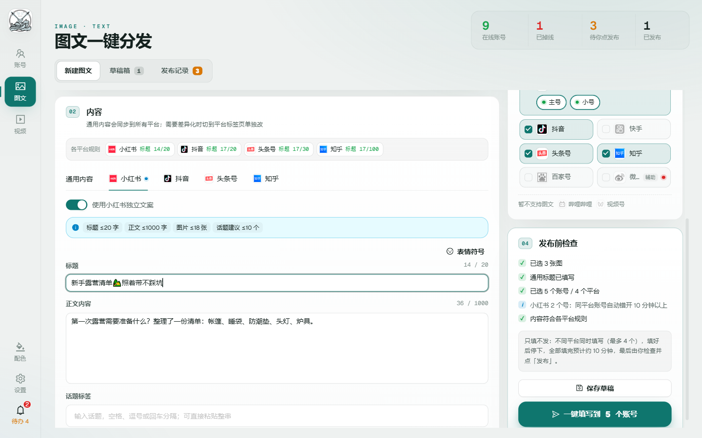
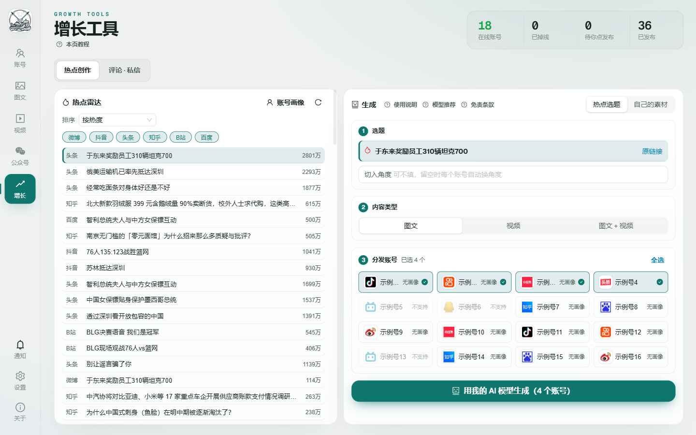
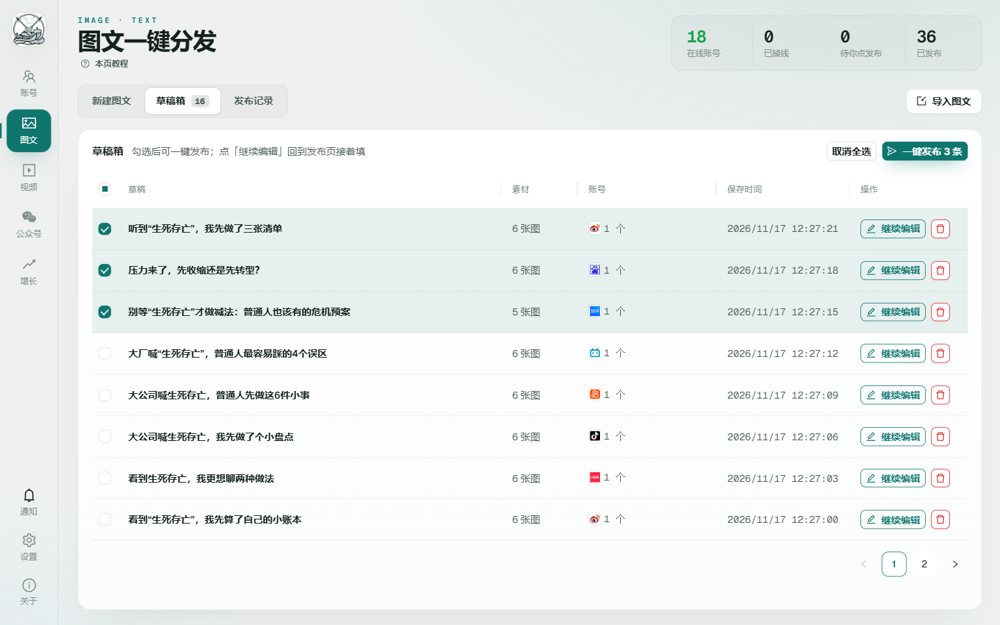

<div align="center">

# 🚀 FanPost · 浪叉多平台发布助手

### 写一次，发 11 个平台。热点、文案、配图、视频、分发，一条线做完。

图文或视频写一次，自动填进抖音、快手、小红书、头条号、视频号、B 站、企鹅号、知乎、百家号、微博的官方创作者后台，公众号走官方接口。<br />
多账号矩阵、批量发布、定时发布、评论统一回复、AI 按账号写稿，全部在一个桌面软件里。

[](https://github.com/Tom-wc/FanPost/releases/latest)
[](https://github.com/Tom-wc/FanPost/releases/latest)
[](#-平台支持)
[](docs/使用教程.md)

<br />



</div>

---

## 💡 为什么用它

| 以前 | 用 FanPost |
|:--|:--|
| 10 个平台挨个打开后台，复制标题、正文、话题，重传图片视频 | 写一次，软件同时填进所有平台，停在发布前给你检查，或直接自动发布 |
| 每个平台字数、图片数、标题规则不一样，发出去才发现超了 | 按平台规则实时校验，分平台单独改文案，不合规当场提示 |
| 多账号来回登录切换，容易串号 | 每个账号独立会话，同平台多号互不干扰，掉线自动提醒 |
| 每天想选题、写稿、配图，一个号就要大半天 | 热点雷达挑选题，AI 按每个账号的风格分别写稿、配图、做视频，审核后一键分发 |
| 评论私信散在各平台，回复不过来 | 评论 · 私信工作台汇总各平台留言，按意图分类，可批量或自动回复 |

---

## ✨ 亮点

<table>
<tr>
<td width="50%" valign="top">

### 📤 一份内容，11 个平台同时填写
自动上传素材、写标题正文话题、选封面和声明。可以停在发布前人工确认，也可以自动点发布并回查结果。不同平台并行填写，同平台多账号自动错开间隔。

### 👥 多账号矩阵，会话隔离
同一平台可登录多个账号，每个账号独立浏览器会话，互不串号。在官方页面扫码登录，软件不经手密码。每 30 分钟自动巡检登录状态，掉线弹通知，一键去登录。

### ✏️ 通用内容打底，分平台微调
一份通用文案同步到所有平台，需要差异化时切到平台标签单独改。字数、图片数、标题规则按平台实时校验；AI 润色、扩写、精简、取标题、生成话题、一稿改多平台。

### 🗂️ 草稿箱 · 批量发布 · 定时发布
没写完存草稿随时接着写；草稿箱勾选多条一键发布，按顺序自动跑完，整批一个进度条、结束一次汇总。也可以设定时间，到点自动填写并发布。

</td>
<td width="50%" valign="top">

### 🔥 热点创作（插件）
六大热榜（微博、抖音、头条、知乎、B 站、百度）实时聚合，按账号赛道排序；AI 从热榜或粉丝评论里挑出账号能切入的选题。<br />
有自己的素材也行：贴进产品介绍或笔记，带上自己的图和视频，AI 按每个账号的画像和平台风格分别改写。<br />
自动配文字卡片图、合成竖屏轮播视频，按平台区分图文 / 视频，审核后**一键分发到所有账号**。

### 💬 评论 · 私信工作台
抓取各平台评论和私信，按咨询、负评等意图分类；AI 按规则起草回复，可以逐条确认，也可以批量或自动发送。

### 📰 公众号专属编辑器
富文本编辑、一键排版、导入 Word / Markdown / 网页文章；通过官方接口存公众号草稿箱，或一键复制带排版的正文。

### 📥 采集导入
网址、公众号文章、Word、PPT、Markdown、PDF、表格批量导入成草稿，保留排版和配图位置。

</td>
</tr>
</table>

<div align="center">

**热点创作：选题 → 内容类型 → 分发账号，三步生成，审核后一键分发**



**草稿箱勾选多条，一键批量发布**



**多平台并行分发，每个平台的状态一目了然**


</div>

---

## 🛡️ 安全与合规，是设计的一部分

- **像人一样操作**：用浏览器原生输入事件逐项填写，不伪装指纹、不调平台内部接口、不改请求；同平台多账号按间隔错开，降低批量操作风险。
- **发布前把关**：敏感词检查、每个账号每天发布次数上限、采集内容照搬比例提醒，规则由服务器签名下发、联网自动更新。
- **AI 内容强制标注**：AI 生成的稿件自动勾选「含 AI 生成内容」声明，不可取消；时政、灾难、医疗、金融等敏感热点不推荐也不生成；多个账号内容相似度过高会拦截，避免矩阵同质化。
- **数据只在本机**：登录状态、草稿、记录只存在你自己的电脑上（Windows `%APPDATA%\fanpost`，macOS `~/Library/Application Support/fanpost`），软件不上传任何账号数据。AI 用你自己选的模型和 Key，按用量直接付给模型服务商。

---

## 📥 下载安装

到 **[Releases](https://github.com/Tom-wc/FanPost/releases/latest)** 下载最新版：

| 系统 | 安装包 |
|:--|:--|
| Windows 10 / 11（64 位） | `FanPost-Setup-x.y.z.exe`，双击安装 |
| macOS（Apple 芯片） | `FanPost-x.y.z-mac-arm64.dmg` |
| macOS（Intel） | `FanPost-x.y.z-mac-x64.dmg` |

<sub>Mac 版未签名，首次打开请在应用上右键 →「打开」。</sub>

安装后在 **设置 → 系统设置 → 授权** 里激活卡密（主卡和插件卡用同一个输入框）。完整操作见 **[使用教程](docs/使用教程.md)**，软件里每个页面的「本页教程」也会直接打开对应章节。

---

## 🧩 平台支持

| 平台 | 图文 | 视频 | 平台 | 图文 | 视频 |
|:--|:--:|:--:|:--|:--:|:--:|
| 抖音 | ✅ | ✅ | 视频号 | — | ✅ |
| 快手 | ✅ | ✅ | 哔哩哔哩 | — | ✅ |
| 小红书 | ✅ | ✅ | 企鹅号 | — | ✅ |
| 头条号 | ✅ | ✅ | 微博 | ✅ | ✅ |
| 知乎 | ✅ | — | 公众号 | 📰 | — |
| 百家号 | ✅ | — | | | |

<sub>✅ 自动填写，可停在发布前确认或自动发布　📰 官方接口存草稿 / 一键复制</sub>

---

## 🔓 开源范围

本仓库是 FanPost 的**开源外壳**：界面和基础框架完全开源，让你了解它如何工作、数据存在哪里。各平台的自动填写流程、公众号接口、采集导入、热点创作和授权是闭源模块，只在发布版里提供。

| 模块 | 开源仓库 | 发布版 |
|:--|:--:|:--:|
| 界面 · 账号管理 · 会话隔离 · 登录检测 | ✅ | ✅ |
| 草稿箱 · 批量发布 · 定时发布 · 发布记录 · 通知中心 · 设置 | ✅ | ✅ |
| 发布调度（并发 / 暂停 / 继续 / 停止 / 间隔） | ✅ | ✅ |
| 平台规则 · 字数校验 · 视频封面 | ✅ | ✅ |
| 评论 · 私信工作台 | ✅ | ✅ |
| 各平台图文 / 视频自动填写流程 | 🔒 | ✅ |
| 公众号接口 · 采集导入 | 🔒 | ✅ |
| 热点创作插件（单独授权） | 🔒 | ✅ |
| 授权 · 安全规则 | 🔒 | ✅ |

<sub>🔒 闭源模块在本仓库里是占位实现，能正常编译运行，用到时会提示下载发布版。</sub>

---

## 🏃 从源码运行

> 环境：Windows 10 / 11 或 macOS，Node.js 22+

```powershell
npm install
npm run dev          # 开发环境（改主进程代码需重启）
npm run typecheck    # TypeScript 检查
npm test             # 单元测试（node:test）
npm run dist         # 打包安装包 → release/
```

开发环境数据在 `%APPDATA%\fanpost-dev`，与发布版 `%APPDATA%\fanpost` 互不影响。设 `FANPOST_USER_DATA_DIR=<目录>` 可另指定一份数据。

<details>
<summary><b>📁 项目结构</b></summary>

```text
src/
├─ main/                 Electron 主进程
│  ├─ index.ts           窗口、IPC、应用生命周期、发布队列
│  ├─ browser-manager.ts 账号会话、发布调度
│  ├─ browser/           登录检测、页面操作工具、发布核对
│  ├─ leads/             评论 · 私信抓取与回复
│  ├─ store.ts           数据读写（原子写入 + 备份恢复）
│  ├─ notify*.ts         通知中心
│  └─ video-cover.ts     FFmpeg 截取视频封面
├─ preload/              暴露给界面的 IPC 接口（window.fanpost）
├─ renderer/src/         React + Ant Design 界面
└─ shared/               平台定义、规则、类型、草稿等纯逻辑
docs/                    使用教程和截图
```

</details>

---

## 🧰 技术栈

`Electron 39` · `electron-vite` · `React 19` · `Ant Design 6` · `TypeScript` · `FFmpeg` · `Chrome DevTools Protocol`

---

## ⚖️ 免责声明

平台页面改版可能让自动填写暂时失效，失效时发布页会留在账号页面里，可手动完成。AI 生成内容由使用者审核后发布，责任由发布者承担。使用时请遵守各平台用户协议、社区规范和法律法规，不要用于批量发布垃圾内容，也不要用来绕过平台安全验证。

## 📄 许可

源代码供学习、研究和个人非商业使用，商用需书面许可，详见 **[LICENSE](LICENSE)**。第三方代码声明见 **[THIRD-PARTY-NOTICES](THIRD-PARTY-NOTICES)**。

---

<sub>关键词：自媒体多平台发布 · 一键分发 · 一文多发 · 矩阵运营 · 多账号管理 · 批量发布 · 定时发布 · AI 写作 · 热点选题 · 评论管理 · 内容分发 · 新媒体管理工具 · 抖音 · 快手 · 小红书 · 头条号 · 视频号 · 哔哩哔哩 · 企鹅号 · 知乎 · 百家号 · 微博 · 公众号 · Electron 桌面应用</sub>
