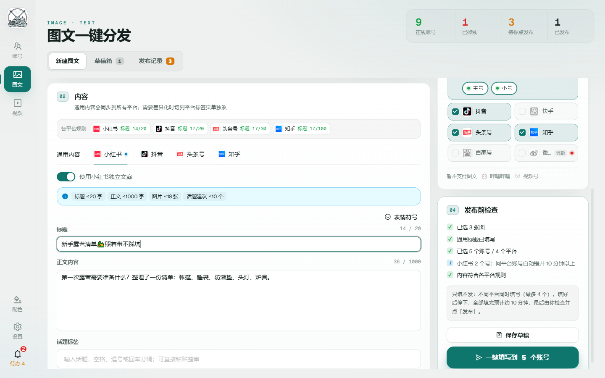
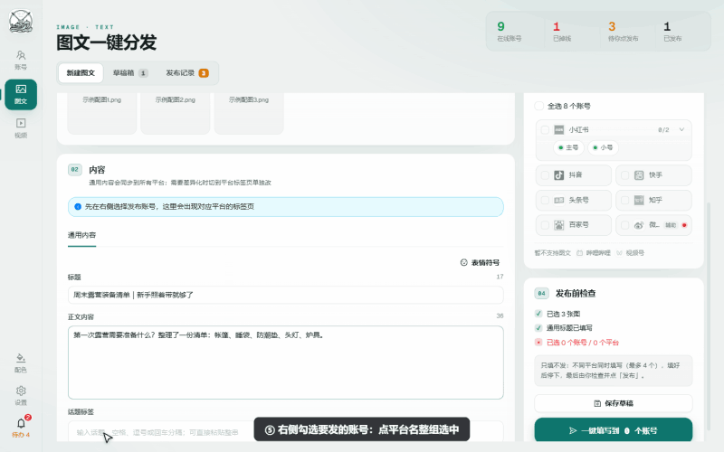

<div align="center">

# 🚀 FanPost · 浪叉多平台发布助手

**一份内容，一次填到 11 个平台。**

图文或视频写一次，自动填进抖音、快手、小红书、头条号、视频号、B 站、企鹅号、知乎、百家号、微博的官方创作者后台，公众号单独走官方接口。

<sub>自媒体多平台一键发布 · 矩阵运营工具 · 一文多发 · 内容分发助手 · 新媒体管理</sub>

[](https://github.com/Tom-wc/FanPost/releases/latest)
[](https://github.com/Tom-wc/FanPost/releases/latest)
[](#-技术栈)

<br />



</div>

---

## ✨ 它能做什么

一次把一篇图文或一个视频，填进所有平台的发布页，停在发布前让你检查，或者让它自动点发布。省掉逐个平台复制粘贴、重传素材的重复劳动。

<table>
<tr>
<td width="50%" valign="top">

**📤 一键分发**
一份内容扇出到 11 个平台，自动上传素材、写标题正文话题。可以停在发布前人工确认，也可以自动发布并回查结果。

**👥 多账号管理**
同平台多个账号，会话互相隔离。官方页面扫码登录，软件不经手密码。每 30 分钟自动巡检登录状态，掉线即时提醒。

**✏️ 分平台微调**
通用内容打底，每个平台可单独改标题、正文、话题，按平台规则实时校验字数和图片数。

</td>
<td width="50%" valign="top">

**📰 公众号专属**
独立编辑页，按公众号规则校验，通过官方接口存入草稿箱，也能一键复制带排版的正文。

**📥 采集导入**
网址、公众号文章、Word、Markdown、PDF、Excel 一键导入成草稿，保留排版和配图位置。

**🗂️ 全程可控**
草稿箱随存随取，发布记录按批次追踪各平台状态，通知中心汇总掉线、待办和结果。

</td>
</tr>
</table>

> 📖 完整操作见 **[使用教程](docs/使用教程.md)**

<div align="center">



</div>

---

## 📥 下载安装

1. 到 **[Releases](https://github.com/Tom-wc/FanPost/releases/latest)** 下载 `FanPost-Setup-x.y.z.exe`
2. 双击安装（Windows 10 / 11）
3. 打开后在 **设置 → 授权** 里激活卡密

---

## 🧩 平台支持

| 平台 | 图文 | 视频 | 平台 | 图文 | 视频 |
|:--|:--:|:--:|:--|:--:|:--:|
| 抖音 | ✅ | ✅ | 视频号 | — | ✅ |
| 快手 | ✅ | ✅ | 哔哩哔哩 | — | ✅ |
| 小红书 | ✅ | ✅ | 企鹅号 | — | ✅ |
| 头条号 | ✅ | ✅ | 微博 | 🅰️ | 🅰️ |
| 知乎 | ✅ | — | 公众号 | 📰 | — |
| 百家号 | ✅ | — | | | |

<sub>✅ 自动填写　🅰️ 辅助模式（文案进剪贴板，上传时自动选素材）　📰 官方接口存草稿 / 一键复制</sub>

---

## 🔓 开源范围

本仓库是 FanPost 的**开源外壳**：界面和基础框架完全开源，让你了解它如何工作、数据存在哪里。各平台的自动填写流程、公众号接口、采集导入和授权是闭源模块，只在发布版里提供。

| 模块 | 开源仓库 | 发布版 |
|:--|:--:|:--:|
| 界面 · 账号管理 · 会话隔离 · 登录检测 | ✅ | ✅ |
| 草稿箱 · 发布记录 · 通知中心 · 设置 | ✅ | ✅ |
| 发布调度（并发 / 暂停 / 继续 / 停止 / 间隔） | ✅ | ✅ |
| 平台规则 · 字数校验 · 视频封面 | ✅ | ✅ |
| 各平台图文 / 视频自动填写流程 | 🔒 | ✅ |
| 公众号接口 · 采集导入 | 🔒 | ✅ |
| 授权 · 安全规则 | 🔒 | ✅ |

<sub>🔒 闭源模块在本仓库里是占位实现，能正常编译运行，用到时会提示下载发布版。</sub>

---

## 🛡️ 账号安全

- **只在你自己的页面里操作**：同平台多账号按设置的间隔依次填写，不同平台可并行。
- **用可信输入**：通过浏览器原生输入事件写入内容，不伪装指纹、不调平台内部接口、不改请求。
- **数据不出本机**：登录状态、草稿、记录只存在本机 `%APPDATA%\fanpost`，软件不上传任何账号数据。

---

## 🏃 从源码运行

> 环境：Windows 10 / 11，Node.js 22+

```powershell
npm install
npm run dev          # 开发环境（改主进程代码需重启）
npm run typecheck    # TypeScript 检查
npm test             # 单元测试（node:test）
npm run dist         # 打包 NSIS 安装包 → release/
```

开发环境数据在 `%APPDATA%\fanpost-dev`，与发布版 `%APPDATA%\fanpost` 互不影响。设 `FANPOST_USER_DATA_DIR=<目录>` 可另指定一份数据。

<details>
<summary><b>📁 项目结构</b></summary>

```text
src/
├─ main/                 Electron 主进程
│  ├─ index.ts           窗口、IPC、应用生命周期
│  ├─ browser-manager.ts 账号会话、发布调度
│  ├─ browser/           登录检测、页面操作工具、发布核对
│  ├─ store.ts           数据读写（原子写入 + 备份恢复）
│  ├─ notify*.ts         通知中心
│  └─ video-cover.ts     FFmpeg 截取视频封面
├─ preload/              暴露给界面的 IPC 接口（window.fanpost）
├─ renderer/src/         React + Ant Design 界面
└─ shared/               平台定义、规则、类型、草稿等纯逻辑
docs/                    使用教程和截图
```

</details>

---

## 🧰 技术栈

`Electron 39` · `electron-vite` · `React 19` · `Ant Design 6` · `TypeScript` · `FFmpeg` · `Chrome DevTools Protocol`

---

## ⚖️ 免责声明

平台页面改版可能让自动填写暂时失效，失效时发布页会留在账号页面里，可手动完成。使用时请遵守各平台用户协议、社区规范和法律法规，不要用于批量发布垃圾内容，也不要用来绕过平台安全验证。

## 📄 许可

源代码供学习、研究和个人非商业使用，商用需书面许可，详见 **[LICENSE](LICENSE)**。第三方代码声明见 **[THIRD-PARTY-NOTICES](THIRD-PARTY-NOTICES)**。

---

<sub>关键词：自媒体多平台发布 · 一键分发 · 一文多发 · 矩阵运营 · 内容分发 · 新媒体管理工具 · 抖音 · 快手 · 小红书 · 头条号 · 视频号 · 哔哩哔哩 · 企鹅号 · 知乎 · 百家号 · 微博 · 公众号 · 批量发布 · Electron 桌面应用</sub>
