# 浪叉多平台发布助手 · 使用教程

一份内容，一次填到抖音、快手、小红书、头条号、视频号、哔哩哔哩、企鹅号、知乎、百家号、微博，共 10 个平台；微信公众号文章在单独的「公众号」入口里编辑、存草稿，合计支持 11 个平台。

发布页右下角有两个按钮：

- **一键填写**：把内容填好后停下，由你在平台页面上检查后亲手点「发布」。
- **一键自动发布**：填好后自动点「发布」，并到平台后台核对是否发出。

第一次使用前，请先看一遍[首次使用会遇到的验证与弹窗](#首次使用会遇到的验证与弹窗)。各平台第一次发布时常会要求短信验证、实名或同意协议，这些只能你本人完成，完成一次后就不会再拦。

> 教程中的动图和截图都用演示账号、演示数据录制，不含真实账号信息。动图里灰色字幕条说明当前这一步在做什么，蓝色圆圈是鼠标点击的位置。

## 目录

- [安装与激活](#安装与激活)
- [5 分钟上手：发一篇图文到 4 个平台](#5-分钟上手发一篇图文到-4-个平台)
- [操作 1：添加平台账号](#操作-1添加平台账号)
- [操作 2：填写内容](#操作-2填写内容)
- [操作 3：选账号、给单个平台改文案](#操作-3选账号给单个平台改文案)
- [操作 4：一键填写，暂停与停止](#操作-4一键填写暂停与停止)
- [操作 5：查看进度和预览，去平台点发布](#操作-5查看进度和预览去平台点发布)
- [操作 6：保存草稿，下次接着填](#操作-6保存草稿下次接着填)
- [操作 7：处理通知和掉线账号](#操作-7处理通知和掉线账号)
- [操作 8：调整设置](#操作-8调整设置)
- [操作 9：公众号文章](#操作-9公众号文章)
- [操作 10：评论 · 私信工作台](#操作-10评论--私信工作台)
- [会员到期与授权提醒](#会员到期与授权提醒)
- [安全检查：敏感词、每日次数、照搬比例](#安全检查敏感词每日次数照搬比例)
- [在哪里查看：常用信息速查](#在哪里查看常用信息速查)
- [关于与免责](#关于与免责)
- [首次使用会遇到的验证与弹窗](#首次使用会遇到的验证与弹窗)
- [软件自动帮你处理的平台要求](#软件自动帮你处理的平台要求)
- [常见问题](#常见问题)

## 安装与激活

1. 用卖家发的网盘链接下载 `FanPost-Setup` 开头的安装包，双击安装。系统要求 Windows 10 / 11 的 **64 位**系统，不支持 32 位系统和 Windows 7 / 8。不确定的话，在「设置 → 系统 → 系统信息」里看「系统类型」，写着「64 位操作系统」就能装。
2. 如果弹出蓝色窗口「Windows 已保护你的电脑」，点「更多信息」，再点「仍要运行」。软件暂时没有购买微软的代码签名证书，Windows 对没签名的软件都会这样提示「未知发布者」，属于正常现象。杀毒软件拦截时，选「允许」或把软件加入信任。
3. 打开软件，进入「设置 → 授权」，粘贴卡密，点「激活」（需要联网）。没激活时不能添加账号、填写和发布。版本、解绑和换电脑的说明见[操作 8](#操作-8调整设置)里的「授权」。

**苹果电脑（Mac）安装**：

1. 看芯片：点左上角苹果图标 →「关于本机」。写着 Apple M1 / M2 / M3 / M4 的下载 `mac-arm64.dmg`，写着 Intel 的下载 `mac-x64.dmg`。
2. 双击 dmg，把软件图标拖进「应用程序」文件夹。
3. Mac 版暂时没有苹果开发者签名，直接打开会提示「已损坏，无法打开」或「无法验证开发者」，这不是文件坏了。打开「终端」（在启动台搜索「终端」），粘贴下面这行后回车，需要时输入开机密码（输入时不显示，输完回车）：

   ```
   sudo xattr -cr /Applications/浪叉多平台发布助手.app
   ```

4. 回到「应用程序」双击打开。仍然被拦的话，进「系统设置 → 隐私与安全性」，在页面下方点「仍要打开」。以上只需做一次，以后覆盖安装新版本时再做一遍第 3 步。

**更新**：永久卡和有效期内的年卡都免费更新。有新版本时，页面顶部会出现一条绿色横幅「新版本 x.x.x 可以更新了」，左侧「关于」图标上有小橙点。点「查看更新」进入关于页，看完整的更新内容，点「去网盘下载」，下载后直接覆盖安装。账号登录、发布记录、草稿和授权都会保留，不用重新激活。横幅关掉后这个版本不再弹出，关于页里随时能看到；也可以随时点「关于 → 检查更新」。

**公告**：维护、平台改版等重要通知会以横幅显示在页面顶部，关掉后不再弹出。

**售后和问题反馈**：左侧「关于」页里有售后二维码，扫码联系我们。反馈时请附上出问题的平台、图文还是视频，以及发布记录卡片上的提示文字或截图。

## 5 分钟上手：发一篇图文到 4 个平台

完整走一遍的顺序如下，每一步的细节和动图在后面对应的章节里。

1. 左侧「账号」→「添加账号」→ 选平台 → 手机扫码登录。要发几个平台就登几个。（[操作 1](#操作-1添加平台账号)）
2. 左侧点「图文」，添加图片，填标题、正文、话题。（[操作 2](#操作-2填写内容)）
3. 在右上「03 发布账号」勾选要发的账号，看右下「04 发布前检查」有没有红色条目。（[操作 3](#操作-3选账号给单个平台改文案)）
4. 点右下角「一键填写到 N 个账号」。顶栏出现进度，可以暂停或停止。（[操作 4](#操作-4一键填写暂停与停止)）
5. 顶部切到「发布记录」→ 点这条记录 → 看每个账号的预览图 → 点「打开发布页」，检查无误后在平台页面上亲手点「发布」。（[操作 5](#操作-5查看进度和预览去平台点发布)）
6. 发完后点「检查是否已发布」，软件核对到作品就标记为发布成功。

## 操作 1：添加平台账号

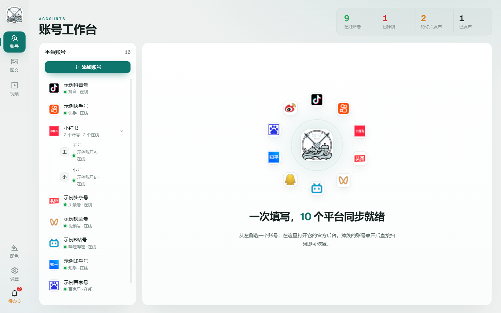

**操作步骤**

1. 左侧导航点「账号」。这里按平台列出已添加的账号，绿点在线、红点掉线。
2. 点右上「添加账号」，在弹窗里选平台。
3. 软件打开该平台官方登录页，用手机 App 扫码登录。
4. 登录成功后账号名会自动出现在列表里，状态变成在线。

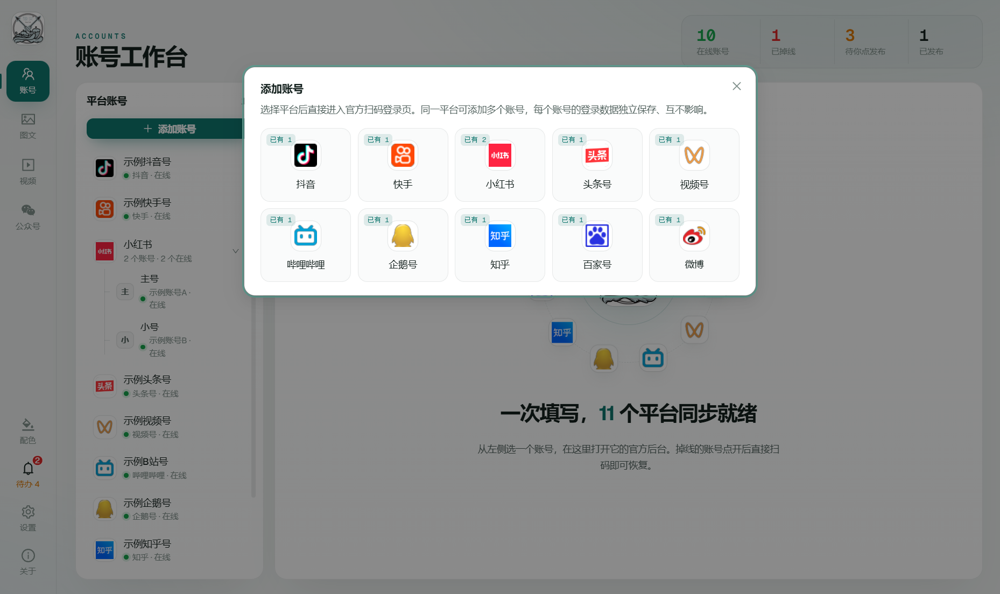

**补充说明**

- 账号密码不经过软件，登录状态只保存在本机。
- 同一平台可以加多个账号（如小红书主号、小号），每个账号的登录会话互相隔离。
- 点列表里的账号，右侧会打开该平台的创作者后台，和在浏览器里用一样。账号右侧可以加备注或删除。
- 软件每 30 分钟自动巡检一次登录状态，掉线会在通知中心提醒（见[操作 7](#操作-7处理通知和掉线账号)）。

## 操作 2：填写内容

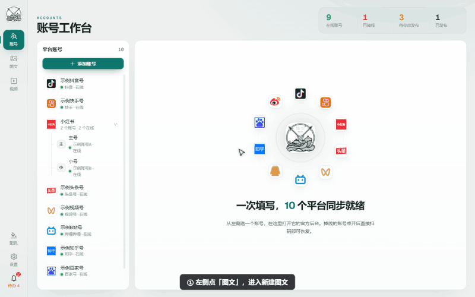

**操作步骤**

1. 左侧导航点「图文」（发视频点「视频」）。顶部停在「新建图文」。
2. 在「01 图片素材」里点击或拖入图片。可以一次加多张，第一张标「首图」；鼠标移到缩略图上可以放大、前移、后移、删除。
3. 在「02 内容 · 通用内容」里填标题、正文。标题框右边显示字数，「各平台规则」里列出每个平台的标题上限。
4. 话题可以一整串粘贴进话题框，比如 `#露营 #户外装备 新手露营`，会自动按空格、逗号、# 拆开并去重。点已有的话题可以原位改，点 × 删除。

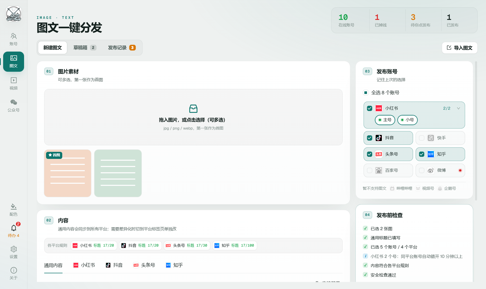

**补充说明**

- 视频页第 1 块是「视频与封面」：只能加一个视频，软件自动截首帧当封面，也可以点「更换封面」换成自己的图。
- 「通用内容」会同步到所有平台；某个平台要单独改，见下一节。
- 正文不要带网址，多数平台会审核不通过。

## 操作 3：选账号、给单个平台改文案


**操作步骤**

1. 在右上「03 发布账号」点平台名，选中该平台下所有在线账号。再点一次取消。
2. 同平台有多个号时，点平台右侧的展开箭头，单独勾选要发的账号（比如只发小红书主号）。
3. 选好后，「通用内容」旁边会出现每个平台的标签页。点「小红书」标签。
4. 打开「使用该平台独立文案」开关，在这个标签里改标题、正文或话题。只影响小红书，其他平台照旧用通用内容。
5. 看右下「04 发布前检查」：素材、标题、账号数、各平台规则逐条列出，红色的是有问题的，点一下会跳到对应平台标签。
6. 在「04 发布前检查」里选「内容声明」（图文、视频都有），默认「无需声明（原创内容）」。内容含 AI 生成、转载、虚构演绎、个人观点或营销推广时，请如实选择，软件会在每个平台选上对应的声明项。某个平台没有这一项时，下面会写明哪些平台不添加。
7. 同一处有「声明原创」开关，默认关，会记住你上次的选择。只有你本人创作的内容才能打开。打开后：
   - 小红书（图文、视频）：自动打开「原创声明」，勾选同意《原创声明须知》，再点「声明原创」。小红书规定视频不足 10 秒不能声明原创（开关是灰的），这时会跳过，卡片上写明视频时长。
   - 其他平台的发布页上目前没有原创选项，不受影响。B站已没有「自制 / 转载」选项，默认按自制投稿。头条的「头条首发」要求 72 小时内只在头条发，和多平台同时发冲突，软件不会勾。
8. 发 B站 视频时，在「哔哩哔哩」标签里选「分区」，默认「知识」。B站会按视频画面自动猜分区和标签，经常猜错（比如把教程猜成游戏、音乐），软件会改成你选的分区，并删掉平台自动加的标签，只留你的话题。

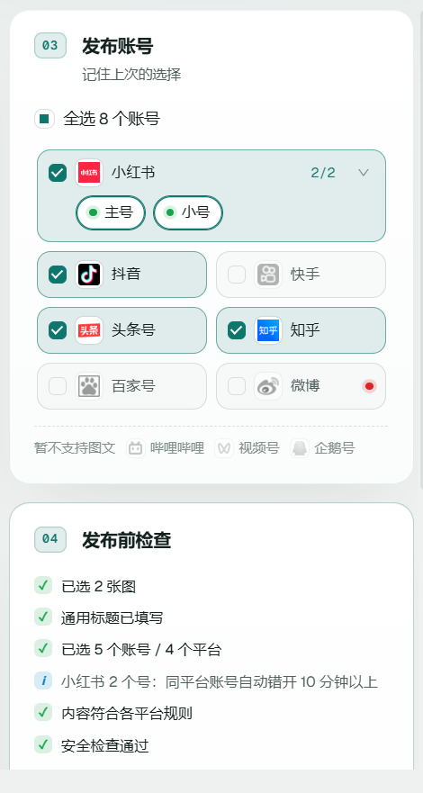

**补充说明**

- 掉线的账号带红点，勾不上；先去重新登录。不支持当前内容类型的平台列在最下面「暂不支持图文 / 暂不支持视频」。目前知乎、百家号只支持图文，发视频时会列在「暂不支持视频」里。

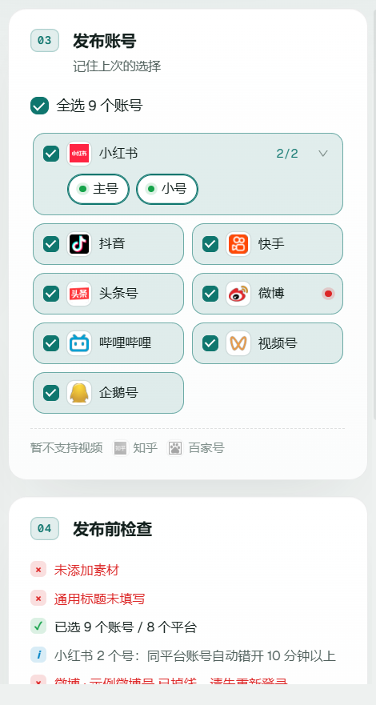

- 平台标签上的红点表示该平台有规则问题，蓝点表示打开了独立文案。
- 开关下方的蓝色提示条写着这个平台的规则：标题和正文字数上限、图片张数、话题建议数，以及辅助模式、需手动插图、需设置封面等注意事项。
- 快手、微博没有标题框，软件会把标题和正文合并写入。

## 操作 4：一键填写，暂停与停止

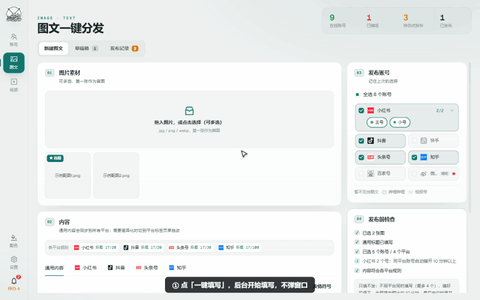

**操作步骤**

1. 检查无误后，点右下角「一键填写到 N 个账号」。按钮上方写着预计总耗时。
2. 提示「已开始填写，进度见顶栏和发布记录」，顶栏出现进度条：已完成几个、正在填哪些账号。
3. 想先停一下，点顶栏「暂停」。正在填的账号填完后停住，不再开始新的；点「继续」接着填。
4. 这次不想填完了，点「停止」并确认。还没开始的账号标为「已停止」，已经填好的保留。

**填写顺序**

- 不同平台的账号同时填写，图文默认最多 4 个一起、视频最多 3 个一起。
- 每个号有时间上限：视频 12 分钟、图文 5 分钟。超时的号会标成「待你处理」，后面的号照常继续，不会被一个号卡住整批。已经点过发布的，后台会继续自动复查；没填完的，点「打开发布页」看停在哪一步。
- 同一平台的多个账号依次填写，前后至少错开 10 分钟，避免被平台识别为同一人批量操作。错开期间顶栏会显示倒计时。
- 同时填写数量和错开时间可以在设置里改（见[操作 8](#操作-8调整设置)）。

填写在后台进行，不弹窗口、不抢焦点。期间可以照常看账号页，或者开始写下一篇。

## 操作 5：查看进度和预览，去平台点发布

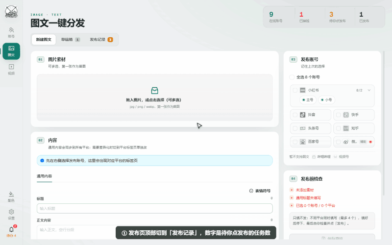

**操作步骤**

1. 发布页顶部切到「发布记录」。每次一键填写是一条记录，标签上的数字是「待你点发布」的任务数。
2. 点记录标题，打开详情：每个账号一张卡片，上面是预览图。
3. 点预览图放大查看，确认标题、正文、图片都填对了。点右上角 × 关掉大图。
4. 点卡片下方「打开发布页」，主界面切到这个账号的平台页面，内容已经填好（不会刷新）。按需补封面、声明等，然后**你自己点平台的「发布」按钮**。
5. 回到发布记录，点「检查是否已发布」。软件在后台打开平台的作品管理页按标题核对，找到就标记为「发布成功」。
6. 账号多时，用顶部「待你点发布」区分进度：没打开过的排在前面；打开过的变灰、带「已打开」标记、排到最后，并显示打开时间。批次标题下会写「N 个还没打开 · 已打开 M 个」。离开发布页后软件会自动去后台核对，找到作品就从列表里消失。
7. 用了「一键自动发布」时，记录的进度栏会分开写：
   - **已发布**：后台已核对到。
   - **等后台确认**：已自动点了发布，平台可能还在审核，软件会在 20 秒、2 分钟、10 分钟后各再查一次。三次都没查到会改成「待你处理」并提醒你。
   - **待你处理**（黄色）：自动点发布没成功，下面一行会写明是哪个平台、什么原因，比如「小红书×2 没找到发布按钮；百家号 要你完成安全验证」。
   - **失败**（红色）：没填成功。

   批次结束的通知标题会写「已发布 X/总数」，内容按平台列出原因。总数和已发布对不上时，看这条通知或进度栏下面那行就知道是谁、为什么。

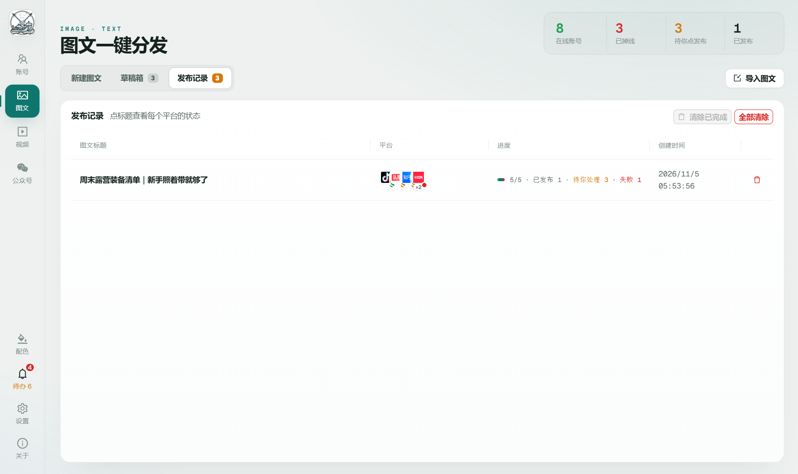

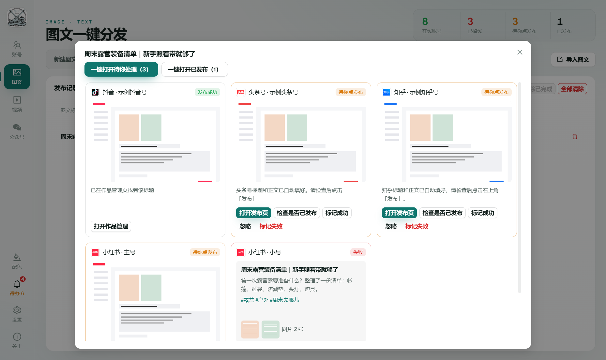

**预览图的含义**

| 任务状态 | 预览显示 |
| --- | --- |
| 填写中 | 账号页的实时画面，约 3 秒刷新一次，右上角标「实时」 |
| 待你点发布 / 失败 | 填写结束那一刻发布页的截图 |
| 排队中 | 还没开始，显示最终会填进这个平台的标题、正文、话题和素材 |
| 发布成功 | 填写时的截图；核对成功的多一个「打开作品管理」按钮 |

**卡片按钮**

- **打开发布页**：切到这个账号已填好的页面。打开过的会变成「再打开（已打开过）」。
- **检查是否已发布**：后台按标题核对作品。
- **标记成功**：你确认已经发出去了，手动标记。
- **标记失败**：这次不发了，填写原因后关闭任务。

填写失败时卡片上会写明原因，比如登录失效、找不到输入框、遇到验证码。

微博走**辅助模式**：软件打开官方发布页，文案复制到剪贴板，你粘贴即可。在页面上点「上传图片 / 上传视频」时会自动选好草稿里的文件，不弹文件选择框。

## 操作 6：保存草稿，下次接着填

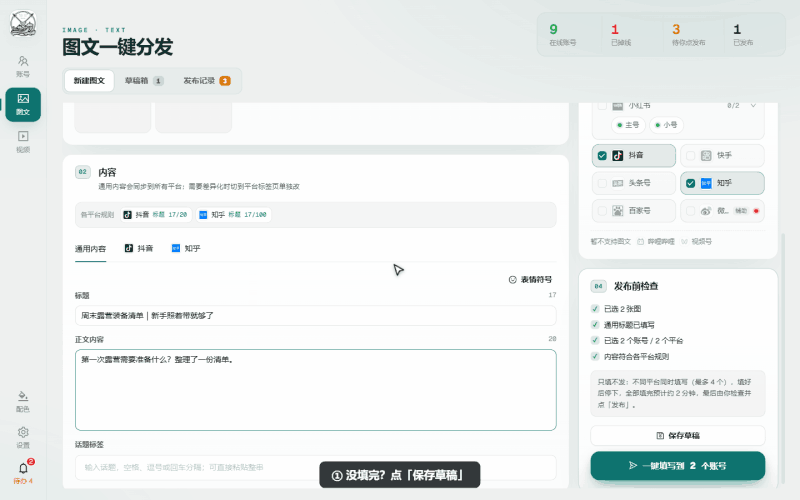

**操作步骤**

1. 内容没填完，点「一键填写」上方的「保存草稿」。按钮会变成「草稿已保存」。
2. 下次打开，发布页顶部切到「草稿箱」（数字是草稿数），在草稿上点「继续编辑」，素材、文案、分平台内容和选中的账号都会恢复。

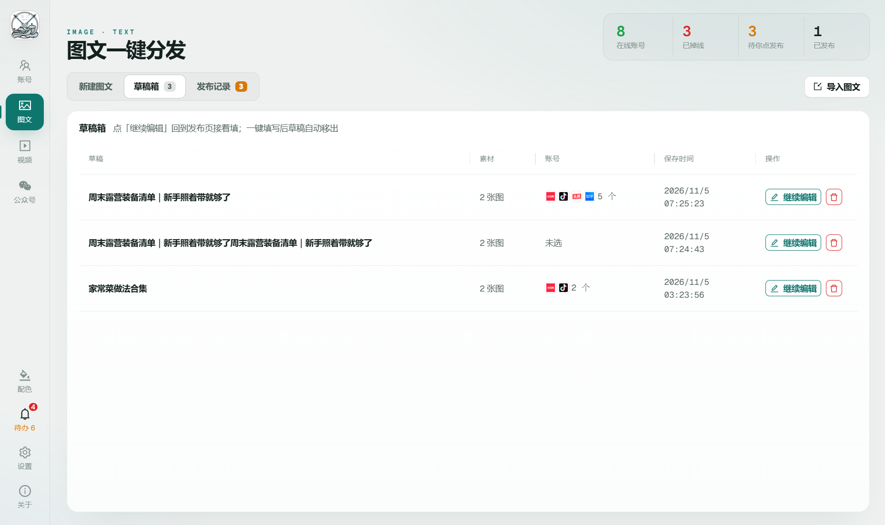

3. 改了内容还没保存时，切到别的页面或关闭软件窗口，会弹出「是否保存草稿？」：
   - **保存草稿**：存进草稿箱再离开。
   - **不保存离开**：放弃这次修改。
   - **取消**：留在发布页继续编辑。

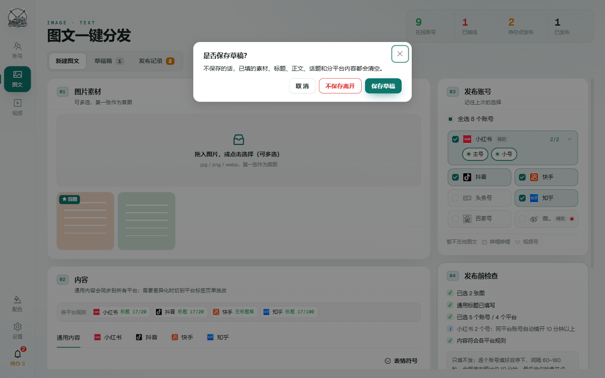

**补充说明**

- 保存按钮会显示当前状态：保存草稿、保存草稿修改、草稿已保存。
- 用草稿一键填写后，这条草稿会自动移出草稿箱。
- 不要的草稿在草稿箱里点「删除」。

## 操作 7：处理通知和掉线账号

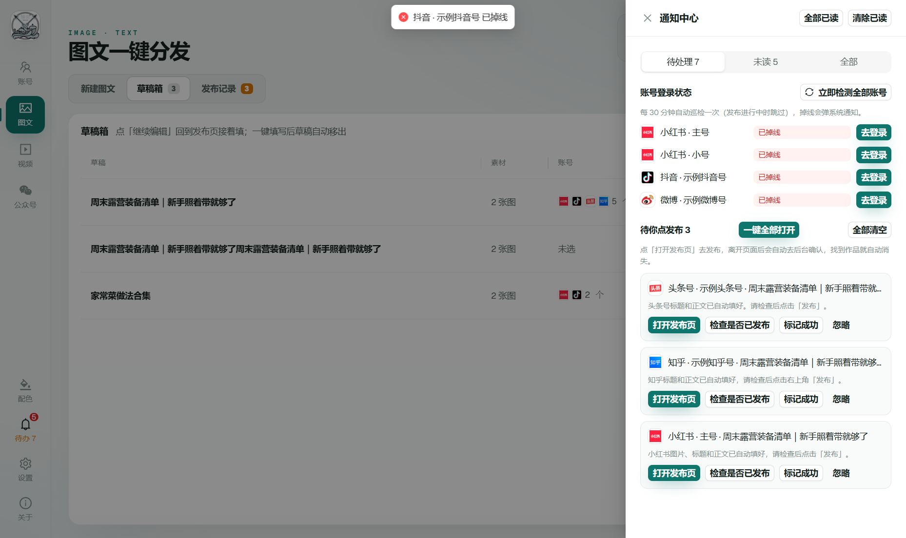

**操作步骤**

1. 左侧栏「待办」（铃铛）有红色角标时，点开通知中心。
2. 「待处理」里是要你动手的事：掉线的账号点「去登录」重新扫码；等你点发布的任务点进去处理。
3. 「未读 / 全部」里是填写完成、失败、成功、整批汇总、账号掉线和恢复等消息。
4. 想马上确认所有账号是否在线，点「立即检测全部账号」。

软件窗口不在前台时，会按设置里的「系统通知」弹 Windows 通知，点击回到通知中心：

- **只提醒需要处理的**（默认）：失败、掉线、需要你验证或手动补设置时弹出，每批结束弹一条汇总。
- **全部**：每个账号填完、失败、成功都弹，批量发布时会比较多。
- **关闭**：不弹，只在通知中心显示。

通知中心里还会出现两类公众号消息：「公众号接口不能用了」和「公众号接口已恢复」，说明见[操作 9](#操作-9公众号文章)里的「接口检测」。

## 操作 8：调整设置

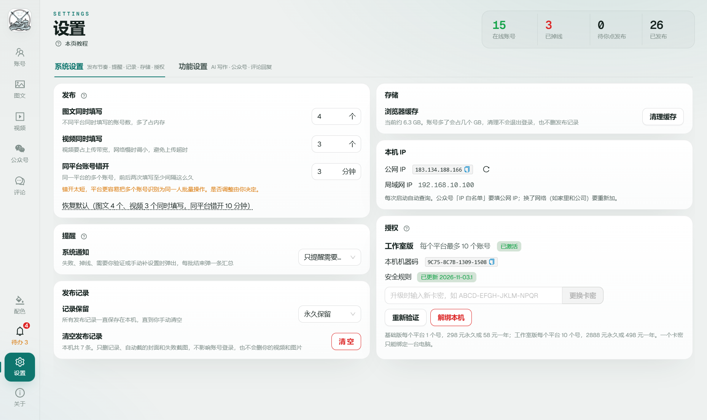

**操作步骤**

1. 左侧栏下方点「设置」（齿轮），进入设置页。设置页顶部分成两个页签，改哪一类就切过去：
   - **系统设置**：左边是发布、提醒、发布记录，右边是存储（浏览器缓存）、本机 IP、授权。
   - **功能设置**：四块卡片 —— AI 写作、评论与私信、公众号、平台覆盖（哪些平台的评论能抓）。
2. 按需修改下面几项。改动后页面底部会出现「保存 / 撤销」，点「保存」生效；没保存就切到别的页面，会先问你要不要保存。

> 卡片里凡是会越来越长的列表（模型、平台标签、回复规则），都定死了高度、条目多了在框内滚动。加了数据也不会把设置页撑变形，下面的内容不会跑出屏幕。

| 设置项 | 默认 | 什么时候改 |
| --- | --- | --- |
| 图文同时填写 | 4 个 | 电脑内存小、卡顿时调小 |
| 视频同时填写 | 3 个 | 网络慢、视频上传超时时调小 |
| 同平台账号错开 | 10 分钟 | 同平台多账号依次填写的最小间隔，号多且怕风控时调大；想快一点可以改成 3 分钟左右，太短（5 分钟以下）设置里会提示风险 |
| 系统通知 | 只提醒需要处理的 | 嫌打扰改「关闭」，想看每个账号的结果改「全部」 |
| 记录保留 | 永久 | 想自动清理旧记录时改短；也可以点「清空发布记录」，草稿还在用的封面不会被删 |
| 浏览器缓存「清理缓存」 | — | 每个账号的内置浏览器会缓存平台页面，账号多了会占几个 GB（设置里显示当前大小）。磁盘紧张时点一下，不会退出登录，也不会删记录；正在填写或发布时不能清理 |
| AI 模型（功能设置） | 未配置 | 添加自己的模型：名称、接口地址、模型名、Key。填完必须先测通才能保存，详见下面[接入自己的 AI 模型](#接入自己的-ai-模型) |
| 只收多久以内的评论（功能设置） | 最近 3 天 | 抓评论的时效线。可选只抓最新一条、1 天、3 天、7 天、30 天、不限时间。评论工作台右上角也能直接改。超过这条线的旧评论抓的时候就跳过了 |
| 允许自动发送（功能设置） | 关闭 | 只有打开后，评论工作台才会真的点「发送」；关着只把话术填进输入框，等你确认 |
| 两条之间停多久（功能设置） | 45 秒 | 同一账号连续回复的间隔。设得再小，实际也不会低于 20 秒 |
| 换号多停多久（功能设置） | 60 秒 | 批量回复换到另一个账号时，在上面的间隔之外再多等这么久。几个号轮着动作比一个号连着动作更像批量操作，填 0 表示不多停 |

### 接入自己的 AI 模型

「功能设置 → AI 写作 → 添加模型」，四个格子填对就能用。编辑器工具条里的润色 / 扩写 / 精简 / 标题 / 话题都走这里配的模型。

| 填什么 | 说明 |
| --- | --- |
| 名称 | 随便起，只是给自己看的标签 |
| 接口地址 | 服务商给的 base URL。**只填到域名也行**，比如 `https://us.oojj.top/`，软件会自动补 `/v1` 再试 |
| API Key | 粘贴完整，别带空格 |
| 模型名 | 点右边「获取列表」，软件会把这家所有模型名列在下面，点一个就填进去。别照价目表手抄 |

**保存前一定会测一次**：点「保存」时软件真的发一句「只回复两个字：可用」过去，通了才存；不通就把原因写在弹窗下方（红条），弹窗不关、配置不落盘。填的过程中也可以点「测试连接」先看结果。

**本地模型要慢一些，这是正常的**：本机跑模型靠自己的 CPU/显卡算，第一次还要把权重读进内存。软件给本地地址放宽了等待时间——探测最多等 3 分钟，生成最多等 10 分钟，弹窗里会写「正在连本机模型，首次要加载权重」。实测参考（同一台机器）：8B 的模型润色一句话 8–12 秒，26B 冷启动要 89 秒、热了以后 22 秒。想日常用，选 8B 左右；26B 留给不赶时间的长文。

常见报错对着看：

| 弹窗里写什么 | 真正的原因 | 怎么解决 |
| --- | --- | --- |
| 模型名不对，这家没有叫这个的模型 | 模型名写错了，比如抄成了中转站价目表上的分组名（`aws0 0.26 4.8`） | 点「获取列表」，从下面列出的模型名里点一个 |
| 这个地址返回的是一张网页，不是接口 | 地址少了 `/v1`，或者填成了中转站首页 | 地址改成 `https://域名/v1`，或者只填域名让软件自动补 |
| Key 不对或已失效（HTTP 401） | Key 复制缺字符、过期、被重置 | 回服务商后台重新复制 |
| 账户余额或额度不够了（HTTP 402） | 余额用完 | 充值 |
| 这个 Key 没有该模型的权限（HTTP 403） | 分组或白名单限制了这个模型 | 换模型，或找服务商开权限 |
| 域名解析不了 | 地址拼错、域名写错 | 检查地址 |
| 请求超时 | 网络不通，或本地模型没启动 | 检查网络 / Ollama 是否在跑。本地模型慢是正常的，提示里会写明等了多少秒 |

**三家常见填法**

| 服务商 | 接口地址 | 模型名 |
| --- | --- | --- |
| DeepSeek | `https://api.deepseek.com/v1` | `deepseek-flash`（快、便宜）/ `deepseek-v4-pro`（写作更强）|
| 中转站（New API / one-api 这类） | `https://你的域名/v1` | 点「获取列表」后从列表里点选，各家上的模型不一样 |
| 本地 Ollama | `http://127.0.0.1:11434/v1` | 填 `ollama list` 里显示的名字，比如 `qwen2.5:7b` |

配好之后回到编辑器，正文上方的 AI 工具条（润色 / 扩写 / 精简 / 标题 / 话题）就走这里配的模型。

**只想改一句话，就先把它选中。** 在正文里选中一段（几十个字也行），工具条右侧会冒出一个浅色小标签「已选中 N 字，只改这一段」。这时候点润色 / 扩写 / 精简：

- 发给模型的只有选中的那段，不是整篇，又快又省；
- 弹窗标题变成「AI 润色 · 选中 N 字」，主按钮变成「替换选中」；
- 点「替换选中」只把这一段换掉，前后文一个字都不动。

不选就是整篇处理，按钮仍是「替换正文」。另外两种情况软件会退回整篇：选区里全是空格换行；选中的是标题框而不是正文。

生成期间如果你又把正文改了，导致那段文字对不上，软件不会去猜位置——会提示「正文已经改过，找不到刚才选中的那段了」，弹窗留着让你手动复制，**正文不会被覆盖**。

**改坏了可以退回。** AI 的结果应用到正文之后，工具条上会出现一个「↺ 还原上一步」，点一下正文就回到这次 AI 修改之前的样子。这个按钮只认最近一次 AI 修改：你自己手动改过正文，它就自动消失（免得把你新写的东西又盖回去）。

**一份内容，一次生成各平台版本。** 工具条最右边的「一稿多平台」：勾上要发的平台（默认全选当前已选的平台），点「开始生成」，软件会一个一个平台地写——快手更口语、小红书带分享感和 emoji、知乎先给结论，「通用内容」一个字都不用改。写完的每一版都能直接改，改完点「采纳」，内容就写进那个平台的独立文案（平台的开关会自动打开），发布时各平台用自己的版本。生成中途可以「停止」，已经写好的版本会留在列表里。

整篇重写比单次润色慢：云端约 3–5 秒一个平台；本地模型一个平台要 20–60 秒，批量建议用云端。

多个模型可以一起存着，在设置里点「设为默认」切换；切换只影响之后的操作。

**授权**

设置页「授权」一栏显示当前版本、每个平台能加几个账号、授权状态、到期日、安全规则版本和本机机器码。软件要先激活卡密才能用。状态标签的颜色和到期提醒见[会员到期与授权提醒](#会员到期与授权提醒)。

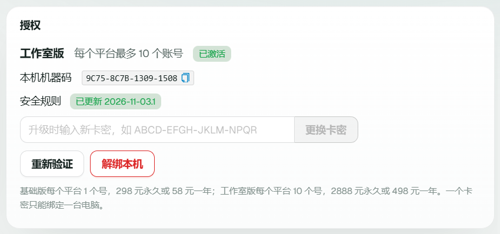

| 版本 | 永久卡（一次买断） | 年卡（激活起 365 天） | 每个平台最多账号 |
| --- | --- | --- | --- |
| 基础版 | 298 元 | 58 元 | 1 个 |
| 工作室版 | 2888 元 | 498 元 | 10 个 |
| 体验卡 | — | 激活后 24 小时内可用 | 1 个 |

- **体验卡**：激活后 24 小时内可以正常使用，额度和基础版一样。授权栏显示「体验版 · 还剩 N 小时」和到期时间。每台电脑、每个网络（同一个公网 IP）都只能用一次体验卡，用过之后再输别的体验卡会被拒绝；体验卡不能在虚拟机里激活，也不能解绑换电脑。激活体验卡要用 1.0.2 及以上版本的软件。正式版卡密不受这些限制。到期后不能再填写和发布，账号登录和发布记录都还在，买正式版卡密后在同一个输入框里输入、点「激活」就能接着用。

- **年卡**：从激活那天起 365 天内可用，授权栏显示「基础版（年卡）/ 工作室版（年卡）· 还剩 N 天」和到期日，最后 30 天标签变成黄色。年卡和永久卡一样可以解绑换电脑，换电脑不会重新计时。到期后买一张新卡密，在同一个输入框里输入、点「更换卡密」就能接着用，账号和发布记录都还在。

- **激活**：在输入框填卡密（16 位字母数字，带不带横线都行），点「激活」。需要联网。一个卡密只能绑定一台电脑。没激活时，添加账号、一键填写、一键发布都会弹出「激活后才能使用」。还没买的，点授权栏里的「购买基础版卡密 / 购买工作室版卡密」会打开闲鱼商品页。
- **升级**：基础版升工作室版时，点「升级到工作室版」去闲鱼购买，拿到卡密后在同一个输入框填入，点「更换卡密」。
- **重新验证**：提示「超过 7 天没连上授权服务器」时，联网后点一下。软件平时每天自动验证一次，断网 7 天内照常使用。
- **解绑本机**：换电脑时先在旧电脑上点「解绑本机」，再到新电脑上激活。每个卡密每月最多解绑 2 次。
- **超出额度**：某个平台的账号数超过当前版本上限时，添加账号、一键填写、一键发布都会被拦下，并弹出「需要升级授权」，写明哪些平台超了。升级后，或删掉多余的账号后，就能恢复使用。

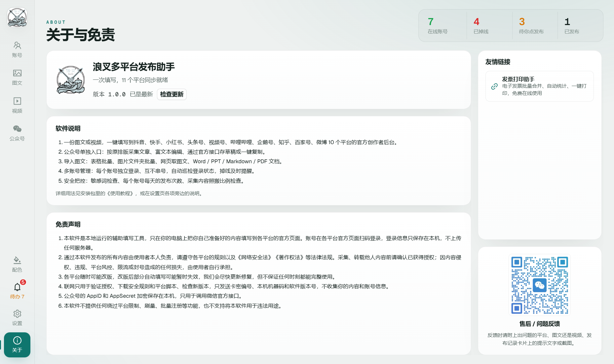

## 操作 9：公众号文章

左侧「公众号」是单独的入口，按公众号的规则编辑，不和图文发布混在一起。

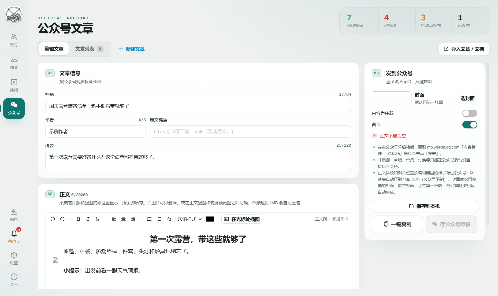

公众号页顶部有四个标签：「新建文章」「文章列表」（保存到本机的文章）「导入文章」「文档」。右侧填标题（最多 64 字）、作者（最多 8 字）、摘要（最多 120 字）、封面，并可勾选「内容为转载」「留言」。正文最多 2 万字。

**一键排版**

正文工具条最右边有个「排版」。点开是左右两块：左边挑模板，右边调参数并实时看效果。

内置的六套是**版式**，不是配色。每套都会把标题、正文、引用、分割线重新排一遍，卡片上那张缩略图就是它真实的长相：

| 版式 | 长相 | 适合 |
| --- | --- | --- |
| 墨线·杂志 | 双细线夹标题，衬线引用 | 深度稿、读书笔记 |
| 卡片·简洁 | 主色实心标题条，浅底引用卡 | 通用，最稳 |
| 公文·红头 | 红头双线、居中标题、首行缩进 | 通知、公告、单位稿 |
| 便签·荧光 | 荧光笔底纹标题，圆点段落 | 生活、种草、轻阅读 |
| 科技·编号 | 编号胶囊标题，左侧渐变条 | 产品、数码、教程 |
| 文艺·楷体 | 楷体正文，菱形装饰 | 散文、情感、文化 |

- 右边五个旋钮：字号、行高、段距、主色、首行缩进。改主色会**连标题条、引用卡的底色一起换**，不是只换字色。改完点「应用到正文」。
- 字号、行高、段距只作用于文字本身：标题字号不会把标题条撑破，卡片的内边距不会跟着变。
- 分不清段落该怎么分也不要紧，排版会自己认：`一、` 当一级标题、`（一）` 当二级、`【重点】` 当小标题，`#` 开头的 Markdown 写法也认；`-` 开头是圆点列表，`1.` 是编号列表，`>` 是引用，`---` 是分割线，`| a | b |` 前后加一行 `| --- | --- |` 就是表格。

**从模板站拿素材**

> 模板站采集是**扩展功能**，要单独购买插件卡密：到「设置 → 功能设置 → 扩展功能」输入插件卡密，点「激活插件」。没激活时排版弹窗里不会出现下面这些入口，内置版式、「用正文现在的版式」和自己存的模板照常能用。插件绑在主卡密上：主卡解绑换电脑，插件跟着过去；主卡到期或失效，插件同时暂停，已经提取过的模板仍然可以套用。
>
> 第一次提取前会弹出使用须知：模板只用于你自己运营的公众号；第三方模板、素材、图片的版权归原作者或站点，付费素材需你已在该站点获得授权；不得转售、打包分发或做成对外模板库；采集只在本机进行，不上传；版权纠纷由使用者自行承担。勾选同意后才能继续。

内置六套不够用、或者就想要某个站里的某个设计，弹窗左栏顶端是先选站名，再打开该站：

| 站 | 打开哪里 | 平时填什么 |
| --- | --- | --- |
| 壹伴 | 样式中心 | 卡片上的那串数字，比如 `500` |
| 135 | 样式大全 | 详情页地址末尾的数字，比如 `166126` |
| 365 | 素材库 | 素材详情地址末尾的数字 |

三步：

1. 点上面那排选站名，再点「打开壹伴，去挑素材」，会用系统浏览器打开该站。
2. 点开一个素材，看地址末尾的数字——壹伴是 `/style_detail/normal/500.html` 里的 `500`。
3. 回来把数字填进框里，点「提取」。

也可以把地址栏链接整条粘进来，站名和数字软件自己会认，不用来回切。ID 是主路径：站点上一条素材的链接往往几十个字符，还夹着一堆参数，记数字比复制链接快。

**一套模板里其实是十几条素材**

站点上的一「套」模板，是十几个素材串起来的一整篇：头图、小标题、正文、引用、分割线、往期推荐……整篇套用等于把别人的文章结构也搬了过来。

所以提取完，右侧预览上方会出现一条「这套里的素材」，一条一张小卡，卡上标着它属于哪一类（大标题 / 小标题 / 正文段落 / 引用 / 分割线）。

- **点一条**：预览里只有这一类块跟着变，其余仍是整套的样子。再点一次退回。
- **叠着挑**：挑了几条可以一起用（标题借这套、引用借那套），旁边会显示「已换 N 类」。
- **一条不挑**：直接点「应用到正文」，就是整套套用。

壹伴样式中心里点开的单条素材页，提取出来就是一条，套上去就是它本来的长相——带图的那种，图会一起带过来。

有一种会被明确拒收：用 div 绝对定位拼出来的**视觉设计稿**（标题是一张图、正文靠百分比定位顶位置）。这种提不出标题和正文的结构，套上去只会换配色，所以宁可不收，直接提示换一套——壹伴的素材通常更完整。

**把别人文章的排版变成自己的模板**

看到一篇排得好看的文章，有两种办法把它变成模板，都在「排版」弹窗里：

1. **贴链接**：把文章地址粘进左上角的框，点「提取」。软件会打开这篇文章，读它的字号、行高、段距、标题颜色，**连卡片结构一起带走**（竖条标题、圆角引用、装饰分割线、段落卡片）。生成的模板放在列表最下面，名字是文章标题的前几个字。
2. **用正文现在的排版**：如果这篇正文已经在软件里（比如刚「导入文章」抓过来的），直接点框下面那行小字「或者：用正文现在的排版」，不用再去复制链接。

三点要说清楚：

- 骨架带的是**结构**，字号颜色字重仍然听上面五个旋钮的。所以套上模板以后，改字号、改主色照样生效，不会被原文的数值焊死。
- 骨架里只保留纯装饰的字（`01`、`•`、`Vol.`），含中文的短句一律清掉——否则每套一次标题就多一句别人的号名。
- 字压在有色底上时（主色标题条、浅色引用卡），软件会按底色自动定字色：深底配白字、浅底配近黑字，不会出现「橙底橙字看不清」。
- 换了模板想再排一次，会先把上一次的骨架拆掉再套，不会一层层套下去；同一套排两遍，结构也不变。

读出来的模板照样可以调，调顺眼了点「把当前设置存成模板」，就存进本机，以后直接选。不想要了，在列表里右键它删掉。

**排版之后的两件事**

- 排版会把正文原有的字体、颜色、字号换成模板的，**图片和链接不动**，位置也不动。所以从别处搬来的文章排一次，样式就统一了。
- 结果是全内联样式（样式写在每个元素身上，不靠外部样式表），所以「一键复制」粘到公众号后台、「存公众号草稿」发出去，样式都不会掉。反过来，如果你在公众号后台自己改过颜色，再排一次会覆盖掉。

排错了不用慌：重新选一套再排一次就行，同一篇排多少遍都不会越套越乱。

右下角三个按钮：

- **保存到本机**：存进「文章列表」，下次接着改。
- **一键复制**：不需要接口，没设置 AppID 也能用。
- **存公众号草稿**：需要先连接公众号接口。没连接时右上角写着「还没填 AppID，只能复制」。

**连接公众号（只用设置一次）**

个人公众号和企业公众号都能按下面的步骤设置。能不能「存公众号草稿」取决于微信给这个号开没开草稿箱接口：设置完点「保存并检测」，再试存一篇；如果提示「没有接口权限（48001）」，说明这个号暂时用不了接口，改用「一键复制」即可。

1. 找到 AppID 和 AppSecret 所在的页面。个人公众号和企业公众号都在这里，按你后台显示的入口选一个：
   - **新版入口（微信开发者平台）**：浏览器打开 [developers.weixin.qq.com](https://developers.weixin.qq.com)，右上角「登录」，用公众号管理员微信扫码，选你的公众号。进入「我的业务」→「公众号」→「基础信息」，能看到 AppID；同一页的「开发密钥」里管 AppSecret 和 IP 白名单。
   - **旧版入口（公众号后台）**：登录 [mp.weixin.qq.com](https://mp.weixin.qq.com)，左侧菜单最下面点「设置与开发 → 基本配置」（部分账号显示为「开发 → 基本配置」）。如果这里提示开发配置已迁移，点提示里的链接，会跳到上面的新版入口。
2. 记下两样东西：
   - **开发者 ID（AppID）**：wx 开头、18 位，直接复制。注意不要填错：「公众号设置 → 账号详情」里的 **原始 ID**（gh_ 开头）和 **微信号** 都不是 AppID。
   - **开发者密码（AppSecret）**：点「启用」或「重置」，管理员微信扫码确认后会显示一次，马上复制保存。之后后台不会再显示它；忘了只能重置，重置后旧的立即失效，软件里也要重新填。
3. 回到软件，左侧「设置 → 系统设置」，找到「本机 IP」，点公网 IP 右边的复制图标。
4. 回到第 1 步的页面，找到「IP 白名单」（新版在「开发密钥」里，旧版在「基本配置」同一页），点「修改 / 编辑」，把刚复制的 IP 粘进去（一行一个），扫码确认。
5. 回到软件「设置 → 功能设置 → 公众号」，填 AppID 和 AppSecret，点「保存并检测」。**这一步只校验格式，连不上也会保存**——家宽 IP 还没加进白名单时也能先存下来。检测通过就显示「已保存，接口正常」，状态标签变成绿色「接口正常 wx…」；没通过会写清原因，处理好后点「检测接口」即可，不用重新填一遍。

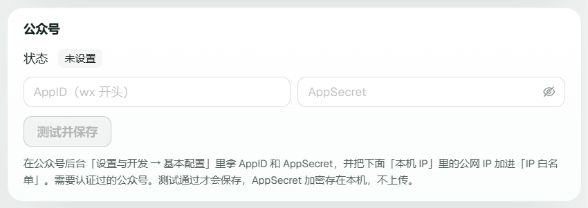

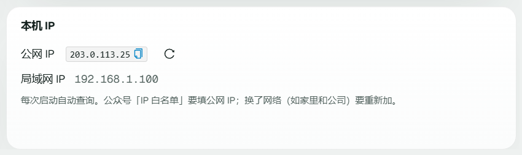

**本机 IP 要注意**

- 「本机 IP」里有两个：**公网 IP** 是要填进白名单的；局域网 IP（192.168 / 10. 开头）只是参考，不要填。
- 软件每次启动自动查一次，右边的刷新按钮可以重新查。
- 换了网络（家里 / 公司 / 手机热点），或者宽带重新拨号后，公网 IP 可能会变。家宽通常是几天一变，变了就要把新 IP 也加进白名单。旧 IP 不用删，可以留着。
- **IP 变了不影响已保存的设置**：AppID 和 AppSecret 一直留着，更新完白名单回来点「检测接口」就恢复，不需要重新填。
- 不确定是不是 IP 的问题，点「检测接口」，失败时提示里会写明「微信看到本机的 IP 是 x.x.x.x」，把这个 IP 加进去即可。

**换公众号或清除**

- 换另一个公众号：直接在下面填新的 AppID 和 AppSecret，按钮同样是「保存并检测」，存进去后旧的被替换；检测不通过也会保存，只是暂时用不了。
- 「一键清除」：AppID 和 AppSecret 都从本机删除。「清空输入」只清输入框，不影响已保存的。
- AppSecret 加密保存在本机，不会上传。

**接口检测**

- 「设置 → 公众号」的状态标签：绿色「接口正常」、红色「接口不可用」、黄色「网络不通，没测成」、灰色「未设置」。下方一行写着上次检测时间。
- 点「检测接口」马上测一次 AppID、AppSecret 和 IP 白名单是否还能用。
- 软件启动 1 分钟后测一次，之后每 6 小时自动测一次。
- 接口不能用了（AppSecret 被重置、IP 变了、权限被收回等）会在通知中心提醒「公众号接口不能用了」，并弹出系统通知，写明原因；修好后再提醒一次「公众号接口已恢复」。网络不通不算失效，不会提醒。
- 接口失效期间「存公众号草稿」会失败，「一键复制」照常能用。

**常见报错对照**

提示末尾括号里的数字是微信的错误码：

| 错误码 | 提示 | 怎么办 |
| --- | --- | --- |
| 40164 / 61004 | 本机的公网 IP 不在「IP 白名单」里 | 把提示里写的 IP（或「设置 → 本机 IP」的公网 IP）加进白名单 |
| 40001 / 40125 | AppSecret 不对，或者被重置过 | 到公众号后台重置 AppSecret，重新填入软件，点「保存并检测」 |
| 40013 | AppID 不对 | 核对开发者 ID，wx 开头 18 位；不要填 gh_ 开头的原始 ID 或微信号 |
| 48001 | 没有接口权限 | 这个号（常见于未认证的个人号）没有草稿箱接口权限，改用「一键复制」；完成微信认证后可以再试 |
| 45009 | 今天的接口调用次数用完了 | 明天再存，或今天先用「一键复制」 |
| 45002 | 正文太长 | 删减正文或拆成两篇 |
| 40007 | 封面图上传失败 | 换一张 jpg / png 封面重试 |

**导入文章**：点「导入文章 / 文档」，粘贴网址或选文档。

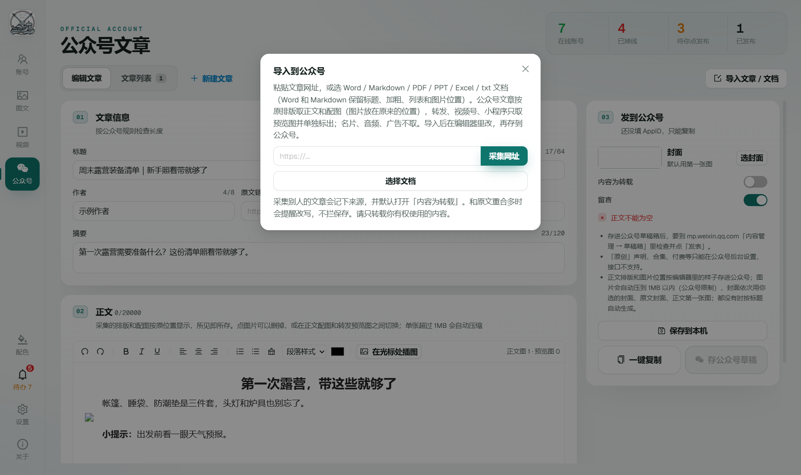

- 文档支持 Word（docx）、Markdown、PDF、PPT、Excel、txt。Word 和 Markdown 保留标题、加粗、斜体、列表、引用，图片放在原来的位置；Markdown 里的本地图片和网络图片都会取进来。PDF 只取文字。
- 公众号文章按原来的排版导入：字体颜色、大小、对齐、加粗、缩进、分段都保留，配图放在原来的位置，不会挪到文末。
- 只取正文和配图。名片、音频、广告、投票、留言区不取。
- 文章里转发的其他文章、视频号、小程序、视频，只取它们的预览图，并标成「预览图」（编辑器里是橙色虚线框），和正文配图分开。导入完会提示识别成哪种文章（图文文章、图片消息、文字消息、转发分享、视频文章）、正文配图几张、预览图几张。
- 多图轮播（SVG 排版）和背景图会拆成普通图片，按原顺序放。
- 别人的文章会记下来源，「内容为转载」默认打开。和原文重合多时只提醒改写，不拦保存；转载请在「原文链接」里填原文地址。

**编辑器**：正文是所见即所得的编辑器，看到的样子就是存进公众号的样子。
- 工具栏：撤销、重做、加粗、斜体、下划线、对齐、编号和圆点列表、清除格式、段落样式（正文、大标题、小标题、引用）、文字颜色。
- 「在光标处插图」：先在正文里点一下要放图的位置，再选图片。
- 点一张图，可以删掉它，或者在「正文配图」和「预览图」之间切换。
- 从别处粘贴进来的内容只保留文字，避免带进乱格式。

**存草稿和一键复制**：
- 「存公众号草稿」把正文按编辑器里的排版存进公众号草稿箱，图片自动上传并压到 1MB 以内。之后到 mp.weixin.qq.com「内容管理 → 草稿箱」检查并点「发表」。
- 「一键复制」把带排版和图片的正文复制到剪贴板，到公众号编辑器正文里 Ctrl+V。标题、作者、摘要另外填。

## 操作 10：评论 · 私信工作台

左侧「评论」页。这里管的是**你自己作品下面收到的评论**：统一抓到一个队列里，按优先级排好，回复。不碰别人的作品，也不做批量关注、私信陌生人。

**抓取评论**
- 点「抓取评论」，软件用你已登录的账号，在后台开一个隐藏页面读评论管理页，读完就关，不改任何东西。
- **只收最近 3 天的评论**（默认）。顶部按钮栏最左边那个下拉框可以改：只抓最新一条、最近 1 天、3 天、7 天、30 天、不限时间。再早的评论抓的时候就跳过了 —— 三天前的咨询，回过去对方多半已经买完或者不看了，回复的意义不大。
- 时间是按平台页面上显示的原样读的（「5 分钟前」「昨天 10:20」「11-10 10:34」「2024-10-02」这几种都认），不是按抓取时刻算。所以很久以前的评论不会被当成刚发的。
- 已经抓过的旧评论如果超出了当前范围，不会删，也不删你的回复记录。列表上方会出现一条带感叹号的提醒：「N 条评论超过「最近 3 天」还没处理」，**只要没处理就一直挂着**，点「展开处理」能看到这些评论并手动回；点「全部忽略」一次清掉（不再算待回复，记录还在本地）。这条提醒只有等你回复了、忽略了，或者把时间范围调宽到能盖住它们，才会消失。
- 如果某个平台的页面这一次没读到时间（改版了），它会明说「没识别到时间，这次没按时间过滤」，评论照收 —— 宁可多收，不会因为没适配就把评论全丢掉。
- 每个平台大约 4 秒。只抓「有回复按钮」的评论，也就是还没回复过的；已经回复过的不会重复出现。
- 抓完顶部会显示：待回复、咨询（问价格/问用法等）、负评、已回复。
- 单个平台失败（掉线、页面改版）只影响那一家，其余照常。

**按账号看、按账号回**
- 一个平台挂了几个号时，评论都收在同一个队列里，但每条都标着「平台 · 账号名」，回复也只会用那条评论所属的号去发，不会发错号。
- 顶部「全部账号」可以只挑某几个号看。列表、顶部的待回复数、批量回复的条数都跟着这个筛选走；筛选着的时候点「抓取评论」，也只抓这几个号，别的号不会被翻一遍。
- 同名重复号（以前重复扫码留下的）后面会带一小段编号，比如「@Jackie #f0ae」，否则下拉里两行一模一样没法选。

**回复**
- 点「回复」，弹窗里会带出这条评论的内容和一条建议话术，可以改。
- 点「填入输入框」：软件会把话术填进这个账号后台那条评论的回复框，然后把账号窗口调出来，你确认后自己点「发送」。这就是默认方式 —— 「只填不发」。
- 想全自动，先在页面右上角打开「自动发送」开关，再勾选弹窗里的「填完自动点发送」。

**批量回复（先勾再发）**
- 打开「自动发送」后，顶部会出现「批量回复 N 条」按钮。点开是一张清单：每条评论、它的平台和账号、将要发出去的话，都摊在你面前。
- 清单默认一条都不勾，勾哪条发哪条，没有「全选发送」。
- 确认后才开始：逐条打开对应账号的评论页，填入并点发送；同一账号两条之间至少停 20 秒（设置里写得再小也按 20 秒算），换到另一个账号时再多停「换号多停多久」那么多秒（默认 60 秒，弹窗底部会写明实际是多久）。
- 顺序是按账号分组的：一个号连着回完再换下一个号，不在几个号之间来回跳。混着发更像机器，出问题也不好定位是哪个号。
- 负评不在清单里；某个平台页面改了或账号掉线，那条会失败并写明原因，不影响后面的。
- 发送中顶部有进度条。想停：关掉「自动发送」开关，正在跑完的那一条会结束，后面的不再继续。

为什么不给「一键全发」：连着多条全自动回复，是最容易被平台判成机器操作的动作。一旦吃到风控，损失的是你自己账号的权重，省下的那几分钟不值。

**回复结果怎么看**
- 「待回复 / 已回复」两个签页可以切换，已回复的会显示发出去的内容和时间。
- 判断是否真的发出去，看的是平台接口的返回，不是「输入框有没有清空」。平台拒绝时会原样告诉你原因，例如微博的「文本内容相同，请隔10分钟再进行发布」，遇到这类提示换一句再试。
- 抓取时如果所有账号都没抓到，会提示「页面都打开了，这些账号现在没有评论可回」，这不是出错。

**回复规则**
- 规则决定「哪类评论用什么话术」。一条规则包含：匹配方式（包含任一关键词 / 同时包含 / 不包含 / 完全等于 / 每条都回）、关键词、多条话术（按顺序轮换）、适用平台、适用账号、单账号每日上限、负评是否转人工。
- 适用账号不选就是「该平台所有号」。同一平台有多个号、想各用一套话术时（比如福利号热情一点、专业号克制一点），在规则里勾上对应的号就行。
- 每日上限按「账号 + 这条规则」各算各的。三条规则各 50 条，就是每个号每条规则各 50 条，不会出现「前一条规则把额度吃光、后一条规则一条没发就被挡」。
- 话术里可以用 `{{author}}`（对方名字）、`{{account}}`（你自己这个号的名字）、`{{platform}}`、`{{content}}`（评论前 40 字）。
- 「加常用模板」可以一次加三条现成的：问价格、问怎么用、通用致谢（默认关）。
- 命中顺序从上往下，命中第一条就停。负评默认不进自动回复，怕说错话。
- 同一账号两次回复至少间隔多少秒，在规则弹窗底部设，默认 45 秒。平台会把「固定话术 + 高频 + 无差别」识别成机械互动，间隔和轮换就是为了避开这个。

**这些平台能做**
头条号、企鹅号、快手、百家号、知乎、微博、哔哩哔哩、小红书八家的评论能直接抓。其中小红书没有「评论管理」页，走的是前台通知中心的「评论和@」，抓到的是别人评论你笔记后通知过来的那几条，同样能直接回复。

抖音的评论不在列表页，要先从作品列表拿到作品 ID 再进单条作品的评论管理（`作品详情 → 评论管理`），这一家还在适配，暂时只能用「回复」里的手动填入。

视频号后台页面渲染不出来、账号又容易掉线，暂不做。

公众号的评论（留言）不走网页，走的是微信开放接口，要同时满足三件事才能接：公众号已认证并开通留言功能、把本机公网 IP 加进公众号后台的「IP 白名单」、再填 AppID 和 AppSecret。这三样缺一样接口都调不通，所以它没有放进这套网页抓取里，只做发布。

**注意**
- 回复里不要放微信号、二维码、外链。那是站外导流，性质比「回复粉丝」重得多，轻则评论被吞，重则封号。
- 微博的评论入口和@消息混在一起，抓到 @ 消息时以「转发链」（//@）开头的内容会自动跳过；如果某条不像评论，直接点「忽略」。
- 抓取和回复都走你自己的登录态，平台改版会导致抓不到，改版后等软件更新即可。
- 回复记录存在本机（`%APPDATA%\fanpost\leads.json`），不上传。

## 会员到期与授权提醒

所有和会员（授权）有关的信息都在左侧「设置 → 授权」。**软件不会弹窗提醒到期**，到期前请看这里的状态标签。

**状态标签怎么看**

| 标签 | 什么时候出现 | 能不能用 |
| --- | --- | --- |
| 绿色「已激活」 | 永久卡；年卡还剩 30 天以上 | 正常使用 |
| 黄色「还剩 N 天 / N 小时」 | 体验卡全程；年卡最后 30 天 | 正常使用，该准备续费了 |
| 红色「暂不可用」 | 到期、换了电脑、超过 7 天没连上授权服务器、授权文件损坏 | 不能添加账号、填写、发布，下面一行写着原因 |

年卡在标签右边还会显示「到期 年-月-日」，体验卡显示到期的具体时间（精确到分钟）。

**到期后会怎样**

- 不能再添加账号、一键填写、一键发布，点这些按钮会弹出提示。
- 已登录的账号、发布记录、草稿、公众号文章都还在，不会删。
- 续费：买新卡密，在「设置 → 授权」同一个输入框里输入，点「激活 / 更换卡密」，马上恢复，不用重新登录账号。

**其他提示**

- **「超过 7 天没连上授权服务器」**：软件每天联网验证一次。断网超过 7 天就会变成「暂不可用」，联网后点「重新验证」即可恢复。
- **「当前账号数超出额度」**（红色提示条）：某个平台的账号数超过了当前版本的上限，后面写着是哪个平台、几个号。删掉多余的号或升级到工作室版后恢复。
- **「安全规则」一行**：显示绿色「已更新 版本号」才正常。显示「未下载」或发布时提示「安全规则还没下载到本机」，联网后点「重新验证」。
- **弹窗「激活后才能使用」**：还没激活卡密。弹窗里可以直接输入卡密激活，或点购买链接。
- **弹窗「需要升级授权」**：超出了当前版本的账号额度，或授权到期、暂不可用，弹窗里写明了原因，也能直接输入新卡密。

## 安全检查：敏感词、每日次数、照搬比例

为了降低封号、限流风险，点「一键填写 / 一键自动发布」前软件会先检查一遍。检查规则（安全规则）由服务器下发，联网时自动更新。

- **敏感词**：标题、正文、话题里含平台常见的违规词时，「04 发布前检查」里会列出是哪个平台、哪一栏、哪个词。红色的必须改掉才能发；黄色的是风险提醒，点发布时会再确认一次，你决定发不发。公众号页只提醒、不拦截，复制前会弹出「N 处敏感词提醒」。
- **每个账号每天的次数**：同一个账号每天能填写的次数有上限，默认每天 5 次；添加不到 7 天的新账号每天 2 次（以服务器下发的规则为准，各平台可能不同）。超了会提示「某账号 今天已填写 N 次，新账号每天最多 M 次，明天再发」，第二天 0 点重置。
- **同平台间隔**：同平台多个账号之间至少错开几分钟，设置里调得太小时会自动按最小值算。
- **照搬比例**：导入或采集的内容和原文重合太多时，会提示「建议改写」；重合非常多时不能直接发，需要改写，或者把内容声明改成「内容为转载」。重合较多时不能打开「声明原创」。

## 在哪里查看：常用信息速查

| 想看什么 | 在哪里 |
| --- | --- |
| 会员版本、到期日、还剩几天 | 设置 → 授权 |
| 每个平台能加几个账号、是否超额度 | 设置 → 授权 |
| 本机机器码、解绑本机 | 设置 → 授权 |
| 安全规则是否已更新 | 设置 → 授权 →「安全规则」一行 |
| 本机公网 IP（填公众号白名单用） | 设置 → 本机 IP |
| 公众号接口是否正常、上次检测时间 | 设置 → 公众号 |
| 公众号 AppID、AppSecret、IP 白名单 | 微信开发者平台 developers.weixin.qq.com → 我的业务 → 公众号 → 基础信息 / 开发密钥；旧版在 mp.weixin.qq.com → 设置与开发 → 基本配置 |
| 存进公众号的草稿 | 公众号后台 → 内容管理 → 草稿箱 |
| 账号是否在线、掉线账号 | 左侧「账号」；或「待办」（通知中心） |
| 每次填写的进度和结果、预览图 | 图文 / 视频页顶部「发布记录」 |
| 没填完的草稿 | 图文 / 视频页顶部「草稿箱」 |
| 公众号文章草稿 | 公众号页「文章列表」 |
| 失败、掉线、公众号接口失效等提醒 | 左侧「待办」（通知中心） |
| 各平台标题字数、图片张数等规则 | 发布页「02 内容」里的「各平台规则」，以及每个平台标签下的蓝色提示条 |
| 当前版本号、更新内容、检查更新 | 左侧「关于」 |
| 售后二维码 | 左侧「关于」 |
| 浏览器缓存大小、清理缓存 | 设置 → 存储 |
| 数据保存位置 | `%APPDATA%\fanpost` |

## 关于与免责


左侧「关于」页：
- 软件名称、当前版本号、检查更新；有新版本时显示完整的更新内容和网盘下载按钮。
- 软件说明：主要功能一览。
- 免责声明：内容责任、平台改版、联网用途、数据保存方式等。
- 售后二维码。
- 友情链接：点击用系统浏览器打开。

## 首次使用会遇到的验证与弹窗

各平台对新账号、新设备或第一次投稿常有一次性的检查。软件不会也不能替你完成这些操作（涉及你本人的手机、身份或协议）。遇到时任务会停下，卡片和通知里会写明原因，**发布页保留在该账号页面里**。你点卡片上的「打开发布页」完成验证，再接着在这个页面上把剩下的步骤做完、点发布即可。以后同一账号一般不会再出现。

**建议：添加账号后先做一次「预热」**

1. 账号页点该账号，右侧打开平台创作者后台。
2. 进入平台自己的「发布视频 / 发布图文」页面，随便上传一个文件，看是否弹出下面任何一项，按提示处理完。
3. 关掉页面不用发布。之后用软件发布就不会被这些弹窗卡住。

**各平台已知的首次检查**

| 平台 | 可能出现 | 出现的位置 | 你需要做什么 |
| --- | --- | --- | --- |
| 哔哩哔哩 | 「请完成短信验证」 | 上传封面或点投稿时 | 在弹窗里获取验证码，用绑定手机接收并填入。完成后软件下次可正常上传封面 |
| 哔哩哔哩 | 「本地浏览器存在未提交的视频」 | 打开投稿页时 | 软件会自动点「不用了」，无需处理 |
| 抖音 | 短信 / 滑块验证 | 登录或首次发布时 | 按页面提示完成 |
| 头条号 | 实名认证提醒 | 首次发布 | 图文不实名也能发；视频若要求实名，按页面提示在手机头条 App 里认证 |
| 视频号 | 微信扫码确认 | 登录、长时间未用后 | 用绑定的微信扫码 |
| 小红书 | 手机号验证 | 新设备首次登录 | 按页面提示完成 |
| 企鹅号 | 登录失败 / 需要 QQ 安全验证 | 登录时 | 在 QQ 手机版确认登录；登不上时先在电脑浏览器登录一次 om.qq.com |
| 百家号 | 「百家号安全验证」（拖动滑块使图片转正 / 扫码验证） | 一键自动发布点下「发布」后，新账号或短时间内连续发布时常出现 | 发布页选了百家号时，下面会有黄色提示提前告诉你。弹出时软件会停下并弹通知提醒你。点「打开发布页」，拖动滑块把图片转正（或用百度 App 扫码），验证通过后若没自动发出就再点一次「发布」。发出后软件会自动去后台确认。多账号连发时建议百家号间隔开（设置 → 同平台间隔） |
| 微博 | 「请进行内容声明（必填）」 | 发视频时 | 软件按你选的「内容声明」自动选，无需处理 |
| 各平台 | 新功能引导、活动弹窗 | 打开发布页时 | 软件会关掉常见的「我知道了」类弹窗；没关掉的不影响填写，发布前点掉即可 |

**任务卡片上的提示怎么读**

| 卡片上写着 | 含义 | 怎么办 |
| --- | --- | --- |
| 登录已失效，请重新扫码登录 | 账号掉线 | 账号页或通知中心点「去登录」 |
| 平台要求登录或安全验证 | 页面弹出了验证码、扫码或安全验证 | 点「打开发布页」完成验证，再在页面上接着发布 |
| 自动发布未完成：平台弹出了安全验证 | 自动点发布后平台要求滑块 / 扫码验证 | 点「打开发布页」完成验证，没自动发出就再点一次「发布」 |
| B站要求短信验证后才能上传封面 | 见上表 | 点「打开发布页」完成短信验证，再在页面上手动传封面 |
| 封面未设置成功（原因） | 封面没传上，视频和文案已填好 | 点「打开发布页」手动设置封面 |
| 抖音封面检测未通过：原因 | 抖音给封面打了低质标签 | 点「打开发布页」换一张不带边框、不是截屏的封面；下次在「视频与封面」里点「选择封面图片」提前换好 |
| 声明未设置成功 | 平台声明控件没选上 | 打开发布页，按卡片上写的声明项手动选 |
| 平台检测建议（未自动采纳，请你判断）：… | 平台自带的内容检测给出了修改建议 | 打开发布页看平台的建议，合理的点「采纳」，不合理的忽略。软件不自动采纳，因为平台建议有时是错的（比如把正确的句子改成病句） |
| 平台检测未发现问题 | 平台自带检测已通过 | 无需处理 |
| 失败（红色）+「打开发布页看原因」 | 自动填写没完成，发布页还停在这个账号里 | 点「打开发布页看原因」看页面现场，补齐后自己点发布；发出后软件会自动去后台确认。通知中心的「发布失败」通知上也有这个按钮 |

## 软件自动帮你处理的平台要求

平台的质量提示（如「封面不佳」）会直接影响推荐量。下面这些软件会自动满足，不需要你操作：

| 平台 | 平台要求 | 软件的处理 |
| --- | --- | --- |
| 抖音 | 竖封面 3:4、横封面 4:3；封面不能有边框，不能像截屏，否则标「封面不佳」限流 | 从视频首帧生成铺满画面的两张封面，自动裁掉视频自带的黑边；上传后点平台「重新检测」，确认「封面检测通过」 |
| 企鹅号视频 | 必须选封面（3:4 和 9:16 两张）；还要做「AI生成声明」，否则提示「存在未进行AI生成声明素材」 | 上传前把视频临时按标题命名（硬链接，不占额外空间），避免列表里显示成原文件名；自动选视频首帧并完成两步裁剪；平台没生成候选帧时，改为上传视频首帧封面（「+」→本地上传）再裁剪；按你选的「内容声明」提交 AI 声明（选了「含AI生成内容」才标注视频为 AI 生成） |
| 头条号 | 竖版视频封面不低于 618×1000，横版 16:9 | 按视频方向生成 1080×1748 或 1920×1080 的完整封面 |
| 哔哩哔哩 | 4:3 和 16:9 两种封面；分区、标签必须和内容相符 | 生成两种比例的完整封面并分别上传；分区改成你选的，删掉平台乱加的标签 |
| 百家号、头条号图文 | 封面 4:3，平台默认会把竖图裁掉一大截 | 从首图生成完整的 4:3 封面（不裁内容） |
| 视频号 | 短标题 6~16 字，只能用文字、数字和《》“”：+？%℃ | 自动去掉不支持的符号（如【】、！），不够 6 字时用简介补足 |
| 知乎 | 文章投稿至相关问题能获得更多曝光 | 按标题和话题自动挑选相关问题投稿；也可在「知乎」标签里指定问题 |
| 微博、抖音、B站、快手、头条、企鹅号、小红书、知乎、百家号 | 内容声明（微博视频必填） | 按你选的「内容声明」在每个平台选对应项（图文和视频都处理） |
| 图文：百家号、知乎、快手、抖音、头条、小红书；视频：抖音、小红书、企鹅号 | 平台自带的内容检测（标点、用词、封面、音乐、清晰度、标题党等） | 填完后自动跑一次平台检测，结果单独显示在任务卡片底部（发布记录 → 点标题；待办列表里也有），绿色为通过、黄色为建议，由你判断是否采纳 |
| 快手图文 | 平台检测提示「作品未添加音乐」 | 自动从平台推荐列表选第一首配上，卡片写「已自动配上平台推荐的背景音乐」，可在页面上更换 |
| 各平台 | 发布页偶发「应用加载失败，请刷新重试」 | 自动刷新最多 2 次；仍失败时任务写明原因，稍后重新发布即可 |
| 知乎 | 正文里的图偶尔显示「加载失败」（图已上传，只是显示没加载出来） | 填完后和你点「打开发布页」时，都会自动重新加载这些图；如果仍有失败，卡片上会提示，刷新页面即可 |

## 常见问题

**提示账号掉线？** 在账号页或通知中心点「去登录」，在弹出的官方页面重新扫码。

**提示找不到输入框？** 一般是平台改版了。发布页会保留在该账号页面里，可以先手动填完发布，再反馈问题。

**「一键填写」和「一键自动发布」选哪个？** 新账号、第一次用某个平台，或者内容比较敏感时，建议用「一键填写」，自己检查后点发布。流程熟了、账号稳定后再用「一键自动发布」。自动发布遇到验证码、安全验证或找不到按钮时会停下，标成「待你处理」，不会乱点。

**会员快到期了，软件会提醒吗？** 不弹窗。年卡最后 30 天、体验卡全程，「设置 → 授权」的状态标签是黄色的「还剩 N 天」，旁边写着到期日。到期后状态变成红色「暂不可用」，添加账号、填写、发布时会弹出提示。建议每周看一眼设置页。

**公众号「存公众号草稿」失败？** 先到「设置 → 公众号」点「检测接口」，按提示处理。最常见的原因是换了网络、公网 IP 变了，把「设置 → 本机 IP」里的新 IP 加进公众号后台的 IP 白名单即可。错误码对照见[操作 9](#操作-9公众号文章)。

**填写中可以关软件吗？** 关窗口会中断正在填写的账号。已经填好的发布页在下次打开后需要重新填写，建议等顶栏进度结束再关。

**数据存在哪里？** `%APPDATA%\fanpost`，包括账号登录状态、草稿和发布记录。不要把这个目录分享给别人。
