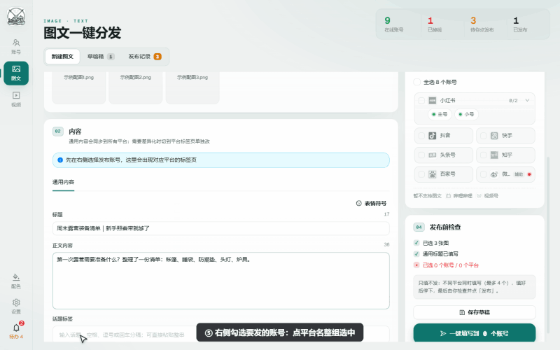
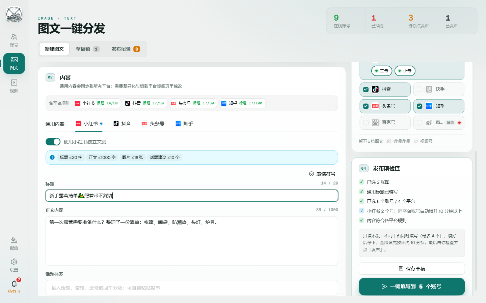
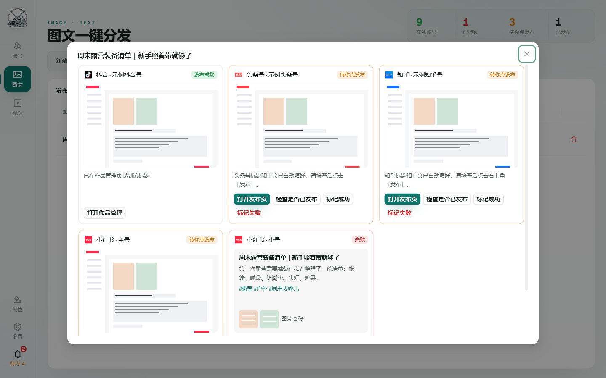
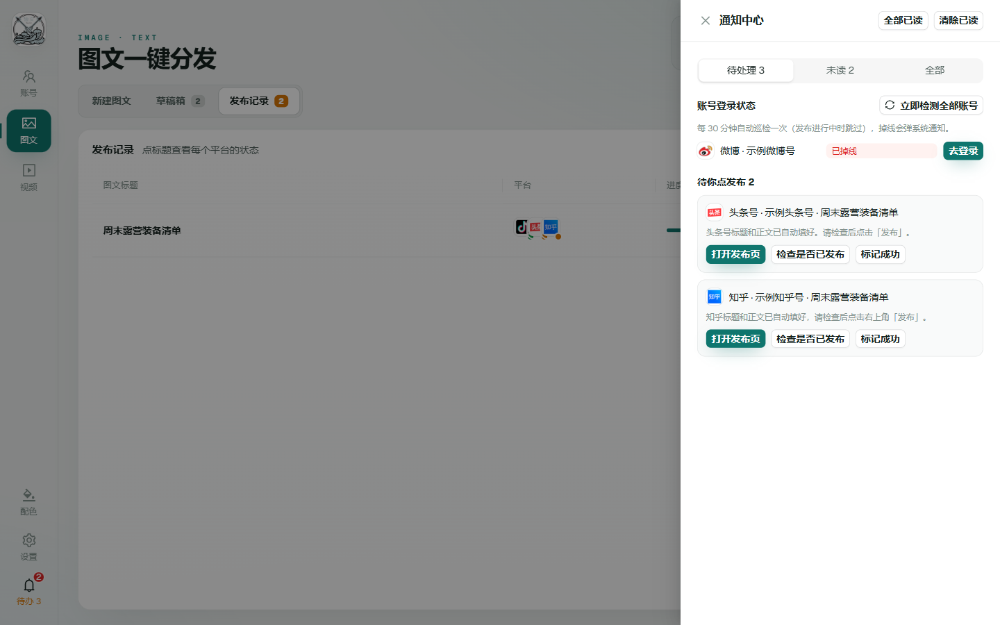
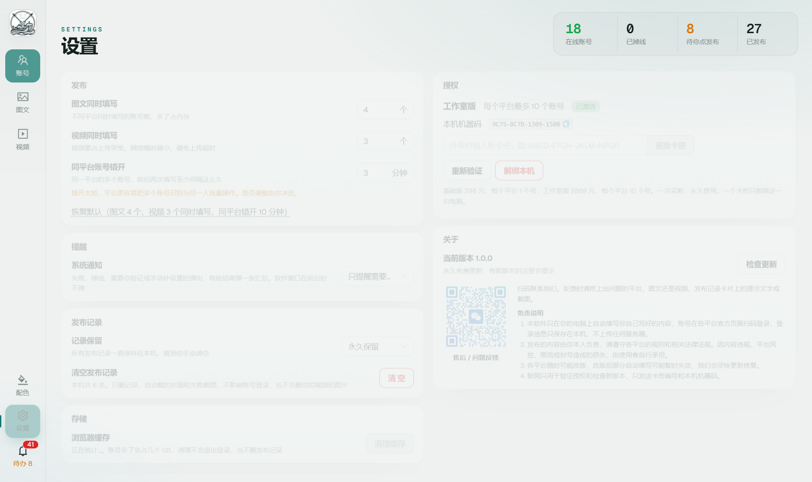

# 浪叉多平台发布助手 · 使用教程

一份内容，一次填到抖音、快手、小红书、头条号、视频号、哔哩哔哩、企鹅号、知乎、百家号、微博。

发布页右下角有两个按钮：

- **一键填写**：把内容填好后停下，由你在平台页面上检查后亲手点「发布」。
- **一键自动发布**：填好后自动点「发布」，并到平台后台核对是否发出。

第一次使用前，请先看一遍[首次使用会遇到的验证与弹窗](#首次使用会遇到的验证与弹窗)。各平台第一次发布时常会要求短信验证、实名或同意协议，这些只能你本人完成，完成一次后就不会再拦。

> 教程中的动图和截图都用演示账号、演示数据录制，不含真实账号信息。动图里灰色字幕条说明当前这一步在做什么，蓝色圆圈是鼠标点击的位置。

## 目录

- [安装与激活](#安装与激活)
- [5 分钟上手：发一篇图文到 4 个平台](#5-分钟上手发一篇图文到-4-个平台)
- [操作 1：添加平台账号](#操作-1添加平台账号)
- [操作 2：填写内容](#操作-2填写内容)
- [操作 3：选账号、给单个平台改文案](#操作-3选账号给单个平台改文案)
- [操作 4：一键填写，暂停与停止](#操作-4一键填写暂停与停止)
- [操作 5：查看进度和预览，去平台点发布](#操作-5查看进度和预览去平台点发布)
- [操作 6：保存草稿，下次接着填](#操作-6保存草稿下次接着填)
- [操作 7：处理通知和掉线账号](#操作-7处理通知和掉线账号)
- [操作 8：调整设置](#操作-8调整设置)
- [操作 9：公众号文章](#操作-9公众号文章)
- [首次使用会遇到的验证与弹窗](#首次使用会遇到的验证与弹窗)
- [软件自动帮你处理的平台要求](#软件自动帮你处理的平台要求)
- [常见问题](#常见问题)

## 安装与激活

1. 用卖家发的网盘链接下载 `FanPost-Setup` 开头的安装包，双击安装。系统要求 Windows 10 / 11（64 位）。
2. 如果弹出蓝色窗口「Windows 已保护你的电脑」，点「更多信息」，再点「仍要运行」。软件暂时没有购买微软的代码签名证书，Windows 对没签名的软件都会这样提示「未知发布者」，属于正常现象。杀毒软件拦截时，选「允许」或把软件加入信任。
3. 打开软件，进入「设置 → 授权」，粘贴卡密，点「激活」（需要联网）。没激活时不能添加账号、填写和发布。版本、解绑和换电脑的说明见[操作 8](#操作-8调整设置)里的「授权」。

**更新**：永久卡和有效期内的年卡都免费更新。有新版本时，页面顶部会出现一条绿色横幅「新版本 x.x.x 可以更新了」，左侧「关于」图标上有小橙点。点「查看更新」进入关于页，看完整的更新内容，点「去网盘下载」，下载后直接覆盖安装。账号登录、发布记录、草稿和授权都会保留，不用重新激活。横幅关掉后这个版本不再弹出，关于页里随时能看到；也可以随时点「关于 → 检查更新」。

**公告**：维护、平台改版等重要通知会以横幅显示在页面顶部，关掉后不再弹出。

**售后和问题反馈**：左侧「关于」页里有售后二维码，扫码联系我们。反馈时请附上出问题的平台、图文还是视频，以及发布记录卡片上的提示文字或截图。

## 5 分钟上手：发一篇图文到 4 个平台

完整走一遍的顺序如下，每一步的细节和动图在后面对应的章节里。

1. 左侧「账号」→「添加账号」→ 选平台 → 手机扫码登录。要发几个平台就登几个。（[操作 1](#操作-1添加平台账号)）
2. 左侧点「图文」，添加图片，填标题、正文、话题。（[操作 2](#操作-2填写内容)）
3. 在右上「03 发布账号」勾选要发的账号，看右下「04 发布前检查」有没有红色条目。（[操作 3](#操作-3选账号给单个平台改文案)）
4. 点右下角「一键填写到 N 个账号」。顶栏出现进度，可以暂停或停止。（[操作 4](#操作-4一键填写暂停与停止)）
5. 顶部切到「发布记录」→ 点这条记录 → 看每个账号的预览图 → 点「打开发布页」，检查无误后在平台页面上亲手点「发布」。（[操作 5](#操作-5查看进度和预览去平台点发布)）
6. 发完后点「检查是否已发布」，软件核对到作品就标记为发布成功。

## 操作 1：添加平台账号

**操作步骤**

1. 左侧导航点「账号」。这里按平台列出已添加的账号，绿点在线、红点掉线。
2. 点右上「添加账号」，在弹窗里选平台。
3. 软件打开该平台官方登录页，用手机 App 扫码登录。
4. 登录成功后账号名会自动出现在列表里，状态变成在线。

**补充说明**

- 账号密码不经过软件，登录状态只保存在本机。
- 同一平台可以加多个账号（如小红书主号、小号），每个账号的登录会话互相隔离。
- 点列表里的账号，右侧会打开该平台的创作者后台，和在浏览器里用一样。账号右侧可以加备注或删除。
- 软件每 30 分钟自动巡检一次登录状态，掉线会在通知中心提醒（见[操作 7](#操作-7处理通知和掉线账号)）。

## 操作 2：填写内容

**操作步骤**

1. 左侧导航点「图文」（发视频点「视频」）。顶部停在「新建图文」。
2. 在「01 图片素材」里点击或拖入图片。可以一次加多张，第一张标「首图」；鼠标移到缩略图上可以放大、前移、后移、删除。
3. 在「02 内容 · 通用内容」里填标题、正文。标题框右边显示字数，「各平台规则」里列出每个平台的标题上限。
4. 话题可以一整串粘贴进话题框，比如 `#露营 #户外装备 新手露营`，会自动按空格、逗号、# 拆开并去重。点已有的话题可以原位改，点 × 删除。

**补充说明**

- 视频页第 1 块是「视频与封面」：只能加一个视频，软件自动截首帧当封面，也可以点「更换封面」换成自己的图。
- 「通用内容」会同步到所有平台；某个平台要单独改，见下一节。
- 正文不要带网址，多数平台会审核不通过。

## 操作 3：选账号、给单个平台改文案

**操作步骤**

1. 在右上「03 发布账号」点平台名，选中该平台下所有在线账号。再点一次取消。
2. 同平台有多个号时，点平台右侧的展开箭头，单独勾选要发的账号（比如只发小红书主号）。
3. 选好后，「通用内容」旁边会出现每个平台的标签页。点「小红书」标签。
4. 打开「使用该平台独立文案」开关，在这个标签里改标题、正文或话题。只影响小红书，其他平台照旧用通用内容。
5. 看右下「04 发布前检查」：素材、标题、账号数、各平台规则逐条列出，红色的是有问题的，点一下会跳到对应平台标签。
6. 在「04 发布前检查」里选「内容声明」（图文、视频都有），默认「无需声明（原创内容）」。内容含 AI 生成、转载、虚构演绎、个人观点或营销推广时，请如实选择，软件会在每个平台选上对应的声明项。某个平台没有这一项时，下面会写明哪些平台不添加。
7. 同一处有「声明原创」开关，默认关，会记住你上次的选择。只有你本人创作的内容才能打开。打开后：
   - 小红书（图文、视频）：自动打开「原创声明」，勾选同意《原创声明须知》，再点「声明原创」。小红书规定视频不足 10 秒不能声明原创（开关是灰的），这时会跳过，卡片上写明视频时长。
   - 其他平台的发布页上目前没有原创选项，不受影响。B站已没有「自制 / 转载」选项，默认按自制投稿。头条的「头条首发」要求 72 小时内只在头条发，和多平台同时发冲突，软件不会勾。
8. 发 B站 视频时，在「哔哩哔哩」标签里选「分区」，默认「知识」。B站会按视频画面自动猜分区和标签，经常猜错（比如把教程猜成游戏、音乐），软件会改成你选的分区，并删掉平台自动加的标签，只留你的话题。

**补充说明**

- 掉线的账号带红点，勾不上；先去重新登录。不支持当前内容类型的平台列在最下面「暂不支持图文」。
- 平台标签上的红点表示该平台有规则问题，蓝点表示打开了独立文案。
- 开关下方的蓝色提示条写着这个平台的规则：标题和正文字数上限、图片张数、话题建议数，以及辅助模式、需手动插图、需设置封面等注意事项。
- 快手、微博没有标题框，软件会把标题和正文合并写入。

## 操作 4：一键填写，暂停与停止

**操作步骤**

1. 检查无误后，点右下角「一键填写到 N 个账号」。按钮上方写着预计总耗时。
2. 提示「已开始填写，进度见顶栏和发布记录」，顶栏出现进度条：已完成几个、正在填哪些账号。
3. 想先停一下，点顶栏「暂停」。正在填的账号填完后停住，不再开始新的；点「继续」接着填。
4. 这次不想填完了，点「停止」并确认。还没开始的账号标为「已停止」，已经填好的保留。

**填写顺序**

- 不同平台的账号同时填写，图文默认最多 4 个一起、视频最多 3 个一起。
- 每个号有时间上限：视频 12 分钟、图文 5 分钟。超时的号会标成「待你处理」，后面的号照常继续，不会被一个号卡住整批。已经点过发布的，后台会继续自动复查；没填完的，点「打开发布页」看停在哪一步。
- 同一平台的多个账号依次填写，前后至少错开 10 分钟，避免被平台识别为同一人批量操作。错开期间顶栏会显示倒计时。
- 同时填写数量和错开时间可以在设置里改（见[操作 8](#操作-8调整设置)）。

填写在后台进行，不弹窗口、不抢焦点。期间可以照常看账号页，或者开始写下一篇。

## 操作 5：查看进度和预览，去平台点发布

**操作步骤**

1. 发布页顶部切到「发布记录」。每次一键填写是一条记录，标签上的数字是「待你点发布」的任务数。
2. 点记录标题，打开详情：每个账号一张卡片，上面是预览图。
3. 点预览图放大查看，确认标题、正文、图片都填对了。点右上角 × 关掉大图。
4. 点卡片下方「打开发布页」，主界面切到这个账号的平台页面，内容已经填好（不会刷新）。按需补封面、声明等，然后**你自己点平台的「发布」按钮**。
5. 回到发布记录，点「检查是否已发布」。软件在后台打开平台的作品管理页按标题核对，找到就标记为「发布成功」。
6. 账号多时，用顶部「待你点发布」区分进度：没打开过的排在前面；打开过的变灰、带「已打开」标记、排到最后，并显示打开时间。批次标题下会写「N 个还没打开 · 已打开 M 个」。离开发布页后软件会自动去后台核对，找到作品就从列表里消失。
7. 用了「一键自动发布」时，记录的进度栏会分开写：
   - **已发布**：后台已核对到。
   - **等后台确认**：已自动点了发布，平台可能还在审核，软件会在 20 秒、2 分钟、10 分钟后各再查一次。三次都没查到会改成「待你处理」并提醒你。
   - **待你处理**（黄色）：自动点发布没成功，下面一行会写明是哪个平台、什么原因，比如「小红书×2 没找到发布按钮；百家号 要你完成安全验证」。
   - **失败**（红色）：没填成功。

   批次结束的通知标题会写「已发布 X/总数」，内容按平台列出原因。总数和已发布对不上时，看这条通知或进度栏下面那行就知道是谁、为什么。

**预览图的含义**

| 任务状态 | 预览显示 |
| --- | --- |
| 填写中 | 账号页的实时画面，约 3 秒刷新一次，右上角标「实时」 |
| 待你点发布 / 失败 | 填写结束那一刻发布页的截图 |
| 排队中 | 还没开始，显示最终会填进这个平台的标题、正文、话题和素材 |
| 发布成功 | 填写时的截图；核对成功的多一个「打开作品管理」按钮 |

**卡片按钮**

- **打开发布页**：切到这个账号已填好的页面。打开过的会变成「再打开（已打开过）」。
- **检查是否已发布**：后台按标题核对作品。
- **标记成功**：你确认已经发出去了，手动标记。
- **标记失败**：这次不发了，填写原因后关闭任务。

填写失败时卡片上会写明原因，比如登录失效、找不到输入框、遇到验证码。

微博走**辅助模式**：软件打开官方发布页，文案复制到剪贴板，你粘贴即可。在页面上点「上传图片 / 上传视频」时会自动选好草稿里的文件，不弹文件选择框。

## 操作 6：保存草稿，下次接着填

**操作步骤**

1. 内容没填完，点「一键填写」上方的「保存草稿」。按钮会变成「草稿已保存」。
2. 下次打开，发布页顶部切到「草稿箱」（数字是草稿数），在草稿上点「继续编辑」，素材、文案、分平台内容和选中的账号都会恢复。
3. 改了内容还没保存时，切到别的页面或关闭软件窗口，会弹出「是否保存草稿？」：
   - **保存草稿**：存进草稿箱再离开。
   - **不保存离开**：放弃这次修改。
   - **取消**：留在发布页继续编辑。

**补充说明**

- 保存按钮会显示当前状态：保存草稿、保存草稿修改、草稿已保存。
- 用草稿一键填写后，这条草稿会自动移出草稿箱。
- 不要的草稿在草稿箱里点「删除」。

## 操作 7：处理通知和掉线账号

**操作步骤**

1. 左侧栏最下方的铃铛有红色角标时，点开通知中心。
2. 「待处理」里是要你动手的事：掉线的账号点「去登录」重新扫码；等你点发布的任务点进去处理。
3. 「未读 / 全部」里是填写完成、失败、成功、整批汇总、账号掉线和恢复等消息。
4. 想马上确认所有账号是否在线，点「立即检测全部账号」。

软件窗口不在前台时，会按设置里的「系统通知」弹 Windows 通知，点击回到通知中心：

- **只提醒需要处理的**（默认）：失败、掉线、需要你验证或手动补设置时弹出，每批结束弹一条汇总。
- **全部**：每个账号填完、失败、成功都弹，批量发布时会比较多。
- **关闭**：不弹，只在通知中心显示。

## 操作 8：调整设置

**操作步骤**

1. 左侧栏下方点「设置」（齿轮），进入设置页。
2. 按需修改下面几项。改动后页面底部会出现「保存 / 撤销」，点「保存」生效；没保存就切到别的页面，会先问你要不要保存。

| 设置项 | 默认 | 什么时候改 |
| --- | --- | --- |
| 图文同时填写 | 4 个 | 电脑内存小、卡顿时调小 |
| 视频同时填写 | 3 个 | 网络慢、视频上传超时时调小 |
| 同平台账号错开 | 10 分钟 | 同平台多账号依次填写的最小间隔，号多且怕风控时调大；想快一点可以改成 3 分钟左右，太短（5 分钟以下）设置里会提示风险 |
| 系统通知 | 只提醒需要处理的 | 嫌打扰改「关闭」，想看每个账号的结果改「全部」 |
| 记录保留 | 永久 | 想自动清理旧记录时改短；也可以点「清空发布记录」，草稿还在用的封面不会被删 |
| 浏览器缓存「清理缓存」 | — | 每个账号的内置浏览器会缓存平台页面，账号多了会占几个 GB（设置里显示当前大小）。磁盘紧张时点一下，不会退出登录，也不会删记录；正在填写或发布时不能清理 |

**授权**

设置页「授权」一栏显示当前版本、每个平台能加几个账号、授权状态（绿色「已激活」正常可用；红色「暂不可用」时下面会写原因）和本机机器码。软件要先激活卡密才能用。

| 版本 | 永久卡（一次买断） | 年卡（激活起 365 天） | 每个平台最多账号 |
| --- | --- | --- | --- |
| 基础版 | 298 元 | 58 元 | 1 个 |
| 工作室版 | 2888 元 | 498 元 | 10 个 |
| 体验卡 | — | 激活后 7 天内可用 | 1 个 |

- **体验卡**：激活后 7 天内可以正常使用，额度和基础版一样。授权栏显示「体验版 · 还剩 N 天」。每台电脑只能用一次体验卡，用过之后再输别的体验卡会被拒绝；体验卡也不能解绑换电脑。到期后不能再填写和发布，账号登录和发布记录都还在，买正式版卡密后在同一个输入框里输入、点「激活」就能接着用。

- **年卡**：从激活那天起 365 天内可用，授权栏显示「基础版（年卡）/ 工作室版（年卡）· 还剩 N 天」和到期日，最后 30 天标签变成黄色。年卡和永久卡一样可以解绑换电脑，换电脑不会重新计时。到期后买一张新卡密，在同一个输入框里输入、点「更换卡密」就能接着用，账号和发布记录都还在。

- **激活**：在输入框填卡密（16 位字母数字，带不带横线都行），点「激活」。需要联网。一个卡密只能绑定一台电脑。没激活时，添加账号、一键填写、一键发布都会弹出「需要激活授权」。还没买的，点授权栏里的「购买基础版卡密 / 购买工作室版卡密」会打开闲鱼商品页。
- **升级**：基础版升工作室版时，点「升级到工作室版」去闲鱼购买，拿到卡密后在同一个输入框填入，点「更换卡密」。
- **重新验证**：提示「超过 7 天没连上授权服务器」时，联网后点一下。软件平时每天自动验证一次，断网 7 天内照常使用。
- **解绑本机**：换电脑时先在旧电脑上点「解绑本机」，再到新电脑上激活。每个卡密每月最多解绑 2 次。
- **超出额度**：某个平台的账号数超过当前版本上限时，添加账号、一键填写、一键发布都会被拦下，并弹出「需要升级授权」，写明哪些平台超了。升级后，或删掉多余的账号后，就能恢复使用。

## 操作 9：公众号文章

左侧「公众号」是单独的入口，按公众号的规则编辑，不和图文发布混在一起。

**连接公众号**：设置 → 公众号，填 AppID 和 AppSecret，点「测试并保存」。要先把设置里「本机 IP」显示的公网 IP 加进公众号后台「设置与开发 → 基本配置 → IP 白名单」。需要认证过的公众号。

**接口检测**：
- 设置 → 公众号 里点「检测接口」，马上测一次 AppID、AppSecret 和 IP 白名单是不是还能用。
- 软件启动 1 分钟后测一次，之后每 6 小时自动测一次。
- 接口不能用了（AppSecret 被重置、IP 变了、权限被收回等）会在通知中心提醒一次，并弹出系统通知，写明原因；修好后再提醒一次「已恢复」。网络不通不算失效，不会提醒。
- 接口失效期间「存公众号草稿」会失败，「一键复制」照常能用。

**导入文章**：点「导入文章 / 文档」，粘贴网址或选文档。
- 文档支持 Word（docx）、Markdown、PDF、PPT、Excel、txt。Word 和 Markdown 保留标题、加粗、斜体、列表、引用，图片放在原来的位置；Markdown 里的本地图片和网络图片都会取进来。PDF 只取文字。
- 公众号文章按原来的排版导入：字体颜色、大小、对齐、加粗、缩进、分段都保留，配图放在原来的位置，不会挪到文末。
- 只取正文和配图。名片、音频、广告、投票、留言区不取。
- 文章里转发的其他文章、视频号、小程序、视频，只取它们的预览图，并标成「预览图」（编辑器里是橙色虚线框），和正文配图分开。导入完会提示识别成哪种文章（图文文章、图片消息、文字消息、转发分享、视频文章）、正文配图几张、预览图几张。
- 多图轮播（SVG 排版）和背景图会拆成普通图片，按原顺序放。
- 别人的文章会记下来源，「内容为转载」默认打开。和原文重合多时只提醒改写，不拦保存；转载请在「原文链接」里填原文地址。

**编辑器**：正文是所见即所得的编辑器，看到的样子就是存进公众号的样子。
- 工具栏：撤销、重做、加粗、斜体、下划线、对齐、编号和圆点列表、清除格式、段落样式（正文、大标题、小标题、引用）、文字颜色。
- 「在光标处插图」：先在正文里点一下要放图的位置，再选图片。
- 点一张图，可以删掉它，或者在「正文配图」和「预览图」之间切换。
- 从别处粘贴进来的内容只保留文字，避免带进乱格式。

**存草稿和一键复制**：
- 「存公众号草稿」把正文按编辑器里的排版存进公众号草稿箱，图片自动上传并压到 1MB 以内。之后到 mp.weixin.qq.com「内容管理 → 草稿箱」检查并点「发表」。
- 「一键复制」把带排版和图片的正文复制到剪贴板，到公众号编辑器正文里 Ctrl+V。标题、作者、摘要另外填。

## 关于与免责

左侧「关于」页：
- 软件名称、当前版本号、检查更新；有新版本时显示完整的更新内容和网盘下载按钮。
- 软件说明：主要功能一览。
- 免责声明：内容责任、平台改版、联网用途、数据保存方式等。
- 售后二维码。
- 友情链接：点击用系统浏览器打开。

## 首次使用会遇到的验证与弹窗

各平台对新账号、新设备或第一次投稿常有一次性的检查。软件不会也不能替你完成这些操作（涉及你本人的手机、身份或协议）。遇到时任务会停下，卡片和通知里会写明原因，**发布页保留在该账号页面里**。你点卡片上的「打开发布页」完成验证，再接着在这个页面上把剩下的步骤做完、点发布即可。以后同一账号一般不会再出现。

**建议：添加账号后先做一次「预热」**

1. 账号页点该账号，右侧打开平台创作者后台。
2. 进入平台自己的「发布视频 / 发布图文」页面，随便上传一个文件，看是否弹出下面任何一项，按提示处理完。
3. 关掉页面不用发布。之后用软件发布就不会被这些弹窗卡住。

**各平台已知的首次检查**

| 平台 | 可能出现 | 出现的位置 | 你需要做什么 |
| --- | --- | --- | --- |
| 哔哩哔哩 | 「请完成短信验证」 | 上传封面或点投稿时 | 在弹窗里获取验证码，用绑定手机接收并填入。完成后软件下次可正常上传封面 |
| 哔哩哔哩 | 「本地浏览器存在未提交的视频」 | 打开投稿页时 | 软件会自动点「不用了」，无需处理 |
| 抖音 | 短信 / 滑块验证 | 登录或首次发布时 | 按页面提示完成 |
| 头条号 | 实名认证提醒 | 首次发布 | 图文不实名也能发；视频若要求实名，按页面提示在手机头条 App 里认证 |
| 视频号 | 微信扫码确认 | 登录、长时间未用后 | 用绑定的微信扫码 |
| 小红书 | 手机号验证 | 新设备首次登录 | 按页面提示完成 |
| 企鹅号 | 登录失败 / 需要 QQ 安全验证 | 登录时 | 在 QQ 手机版确认登录；登不上时先在电脑浏览器登录一次 om.qq.com |
| 百家号 | 「百家号安全验证」（拖动滑块使图片转正 / 扫码验证） | 一键自动发布点下「发布」后，新账号或短时间内连续发布时常出现 | 发布页选了百家号时，下面会有黄色提示提前告诉你。弹出时软件会停下并弹通知提醒你。点「打开发布页」，拖动滑块把图片转正（或用百度 App 扫码），验证通过后若没自动发出就再点一次「发布」。发出后软件会自动去后台确认。多账号连发时建议百家号间隔开（设置 → 同平台间隔） |
| 微博 | 「请进行内容声明（必填）」 | 发视频时 | 软件按你选的「内容声明」自动选，无需处理 |
| 各平台 | 新功能引导、活动弹窗 | 打开发布页时 | 软件会关掉常见的「我知道了」类弹窗；没关掉的不影响填写，发布前点掉即可 |

**任务卡片上的提示怎么读**

| 卡片上写着 | 含义 | 怎么办 |
| --- | --- | --- |
| 登录已失效，请重新扫码登录 | 账号掉线 | 账号页或通知中心点「去登录」 |
| 平台要求登录或安全验证 | 页面弹出了验证码、扫码或安全验证 | 点「打开发布页」完成验证，再在页面上接着发布 |
| 自动发布未完成：平台弹出了安全验证 | 自动点发布后平台要求滑块 / 扫码验证 | 点「打开发布页」完成验证，没自动发出就再点一次「发布」 |
| B站要求短信验证后才能上传封面 | 见上表 | 点「打开发布页」完成短信验证，再在页面上手动传封面 |
| 封面未设置成功（原因） | 封面没传上，视频和文案已填好 | 点「打开发布页」手动设置封面 |
| 抖音封面检测未通过：原因 | 抖音给封面打了低质标签 | 点「打开发布页」换一张不带边框、不是截屏的封面；下次在「视频与封面」里点「选择封面图片」提前换好 |
| 声明未设置成功 | 平台声明控件没选上 | 打开发布页，按卡片上写的声明项手动选 |
| 平台检测建议（未自动采纳，请你判断）：… | 平台自带的内容检测给出了修改建议 | 打开发布页看平台的建议，合理的点「采纳」，不合理的忽略。软件不自动采纳，因为平台建议有时是错的（比如把正确的句子改成病句） |
| 平台检测未发现问题 | 平台自带检测已通过 | 无需处理 |
| 失败（红色）+「打开发布页看原因」 | 自动填写没完成，发布页还停在这个账号里 | 点「打开发布页看原因」看页面现场，补齐后自己点发布；发出后软件会自动去后台确认。通知中心的「发布失败」通知上也有这个按钮 |

## 软件自动帮你处理的平台要求

平台的质量提示（如「封面不佳」）会直接影响推荐量。下面这些软件会自动满足，不需要你操作：

| 平台 | 平台要求 | 软件的处理 |
| --- | --- | --- |
| 抖音 | 竖封面 3:4、横封面 4:3；封面不能有边框，不能像截屏，否则标「封面不佳」限流 | 从视频首帧生成铺满画面的两张封面，自动裁掉视频自带的黑边；上传后点平台「重新检测」，确认「封面检测通过」 |
| 企鹅号视频 | 必须选封面（3:4 和 9:16 两张）；还要做「AI生成声明」，否则提示「存在未进行AI生成声明素材」 | 上传前把视频临时按标题命名（硬链接，不占额外空间），避免列表里显示成原文件名；自动选视频首帧并完成两步裁剪；平台没生成候选帧时，改为上传视频首帧封面（「+」→本地上传）再裁剪；按你选的「内容声明」提交 AI 声明（选了「含AI生成内容」才标注视频为 AI 生成） |
| 头条号 | 竖版视频封面不低于 618×1000，横版 16:9 | 按视频方向生成 1080×1748 或 1920×1080 的完整封面 |
| 哔哩哔哩 | 4:3 和 16:9 两种封面；分区、标签必须和内容相符 | 生成两种比例的完整封面并分别上传；分区改成你选的，删掉平台乱加的标签 |
| 百家号、头条号图文 | 封面 4:3，平台默认会把竖图裁掉一大截 | 从首图生成完整的 4:3 封面（不裁内容） |
| 视频号 | 短标题 6~16 字，只能用文字、数字和《》“”：+？%℃ | 自动去掉不支持的符号（如【】、！），不够 6 字时用简介补足 |
| 知乎 | 文章投稿至相关问题能获得更多曝光 | 按标题和话题自动挑选相关问题投稿；也可在「知乎」标签里指定问题 |
| 微博、抖音、B站、快手、头条、企鹅号、小红书、知乎、百家号 | 内容声明（微博视频必填） | 按你选的「内容声明」在每个平台选对应项（图文和视频都处理） |
| 图文：百家号、知乎、快手、抖音、头条、小红书；视频：抖音、小红书、企鹅号 | 平台自带的内容检测（标点、用词、封面、音乐、清晰度、标题党等） | 填完后自动跑一次平台检测，结果单独显示在任务卡片底部（发布记录 → 点标题；待办列表里也有），绿色为通过、黄色为建议，由你判断是否采纳 |
| 快手图文 | 平台检测提示「作品未添加音乐」 | 自动从平台推荐列表选第一首配上，卡片写「已自动配上平台推荐的背景音乐」，可在页面上更换 |
| 各平台 | 发布页偶发「应用加载失败，请刷新重试」 | 自动刷新最多 2 次；仍失败时任务写明原因，稍后重新发布即可 |
| 知乎 | 正文里的图偶尔显示「加载失败」（图已上传，只是显示没加载出来） | 填完后和你点「打开发布页」时，都会自动重新加载这些图；如果仍有失败，卡片上会提示，刷新页面即可 |

## 常见问题

**提示账号掉线？** 在账号页或通知中心点「去登录」，在弹出的官方页面重新扫码。

**提示找不到输入框？** 一般是平台改版了。发布页会保留在该账号页面里，可以先手动填完发布，再反馈问题。

**为什么不帮我直接点发布？** 各平台发布前常有专栏、话题、原创声明等设置，自动点发布出错概率高，也更容易触发风控。

**填写中可以关软件吗？** 关窗口会中断正在填写的账号。已经填好的发布页在下次打开后需要重新填写，建议等顶栏进度结束再关。

**数据存在哪里？** `%APPDATA%\fanpost`，包括账号登录状态、草稿和发布记录。不要把这个目录分享给别人。
